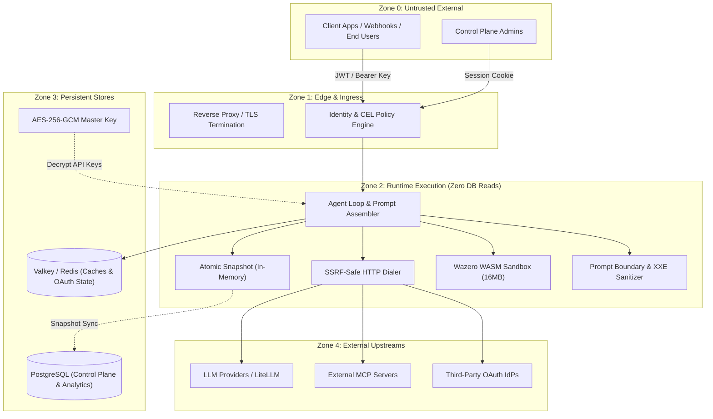

# Beavend Threat Model & Security Architecture

## Overview

Beavend is a Backend-as-a-Service (BaaS) and runtime engine for generative AI applications. It operates in multi-tenant enterprise and cloud environments where untrusted callers, external LLM providers, and third-party tools interact.

This document details the threat boundaries, attack surfaces, and the **17 core security controls** implemented across Beavend's runtime, control plane, memory layer, tool execution sandboxes, and configuration lifecycle.

---

## Threat Boundaries & Trust Zones

---

## The 17 Security Controls

### Control 1: Unauthenticated Prompt Leakage Prevention
- **Threat:** Malicious callers attempting to extract internal system prompts, system instructions, or proprietary prompt chaining logic.
- **Mitigation:**
  - Prompt templates are compiled exclusively into the in-memory immutable `Snapshot`.
  - No public API allows inspecting raw prompt templates or intermediate fragments.
  - Endpoints serving inference require cryptographic identity assertion (Firebase/Supabase/OIDC JWT or high-entropy App API Keys) validated against CEL access policies.

### Control 2: Provider Credential Leakage Prevention (Invariant #5)
- **Threat:** Exposing LLM provider API keys (OpenAI, Anthropic, LiteLLM) in client responses, logs, snapshot distributions, or declarative configuration exports.
- **Mitigation:**
  - Provider credentials never leave the control plane or runtime executor unencrypted.
  - Snapshot compilers and runtime HTTP streams redact credential fields.
  - Configuration-as-Code export masks API keys with `[SECRET_MASKED]`.
  - Keys are encrypted at rest using AES-256-GCM with a 32-byte master key (`internal/secrets`).

### Control 3: Cross-Tenant Cache Poisoning Prevention
- **Threat:** An adversary crafting requests that retrieve or corrupt responses belonging to another tenant or project environment.
- **Mitigation:**
  - Exact match and semantic cache keys are namespaced hierarchically:
    `cache:{project_id}:{env}:{app_id}:{model_routing_id}:{prompt_version}:{payload_sha256}`.
  - Multi-tenant partitioning guarantees tenant isolation even on shared Redis/Valkey clusters.

### Control 4: Hot-Path DB Read Zeroing (Invariant #1)
- **Threat:** Denial of Service (DoS) through connection starvation and read pool exhaustion on Postgres under high inference load.
- **Mitigation:**
  - Zero database queries are executed on the runtime request path (`internal/runtime`).
  - All routing tables, CEL policies, tools, prompts, skills, and limit rules are pre-compiled into an atomic lock-free snapshot (`atomic.Pointer[Snapshot]`).
  - Snapshot updates are published via Valkey/Redis PubSub (`internal/snapshot/sync`).

### Control 5: Out-of-Band Context Compaction
- **Threat:** Context-stuffing attacks exhausting LLM token windows, leading to exorbitant operational costs or denial of service.
- **Mitigation:**
  - Large conversation sessions trigger compaction out-of-band using sliding windows and summary condensation (`internal/memory/compactor.go`).
  - Request processing avoids synchronous database locking during memory consolidation.

### Control 6: Server-Side Tool Execution Isolation (SSRF Safe Dialer)
- **Threat:** Server-Side Request Forgery (SSRF) where tool executors or MCP endpoints are targeted at internal cloud metadata endpoints (`169.254.169.254`), loopback addresses (`127.0.0.1`), or RFC 1918 private subnets (`10.0.0.0/8`, `172.16.0.0/12`, `192.168.0.0/16`).
- **Mitigation:**
  - All outbound HTTP/SSE traffic routes through `SafeDialer` (`internal/tools/ssrf.go`).
  - DNS resolution inspects all resolved IPv4/IPv6 addresses against forbidden CIDRs before initiating a connection.
  - Allowed destination ports are strictly restricted to standard web ports (80 and 443).
  - Outbound response sizes and timeouts are strictly capped.

### Control 7: Client-Side Tool Confirmation Tokens (HMAC-SHA256 Continuation)
- **Threat:** Adversary replaying, tampering with, or spoofing client-side tool approvals (e.g. approving a malicious financial transfer).
- **Mitigation:**
  - Sensitive tools configured with `confirmation: "required"` issue an HMAC-SHA256 signed continuation token (`internal/tools/continuation.go`).
  - Tokens bundle 9 immutable claims: `user_id`, `session_id`, `app_id`, `tool_id`, `tool_call_id`, `arguments_hash`, `env`, `exp`, and a cryptographically random `nonce`.
  - Nonces are stored in Valkey with a short TTL and marked as single-use upon resume, preventing replay attacks.

### Control 8: MCP Stdio Allowlist Enforcement
- **Threat:** Remote code execution (RCE) via arbitrary command execution over Model Context Protocol (MCP) `stdio` transport.
- **Mitigation:**
  - `stdio` transport is disabled by default (`BEAVEND_MCP_ALLOW_STDIO=false`).
  - When explicitly enabled by the operator, commands are strictly validated against an immutable, operator-defined allowlist (`BEAVEND_MCP_STDIO_ALLOWLIST`).
  - Process execution executes with context cancellation timeouts and stripped environments.

### Control 9: MCP OAuth PKCE & Single-Use State Tokens
- **Threat:** Authorization code interception and CSRF during MCP OAuth discovery and token exchange.
- **Mitigation:**
  - Enforces RFC 7636 Proof Key for Code Exchange (PKCE) with SHA-256 (`code_challenge_method: "S256"`).
  - RFC 7591 Dynamic Client Registration (DCR) performed via SSRF-safe HTTP clients.
  - Single-use Redis OAuth `state` tokens bound to `(admin_user_id, project_id, env, tool_id)` and deleted immediately on verification.
  - Stored access and refresh tokens are encrypted at rest with AES-256-GCM.

### Control 10: Sandboxed WebAssembly (WASM) Isolation
- **Threat:** Untrusted tool execution consuming host resources, escaping filesystem sandboxes, or tampering with host processes.
- **Mitigation:**
  - Executed via Wazero pure-Go WebAssembly runtime without cgo or host OS syscall access (`internal/tools/wasm.go`).
  - Hard memory cap of 16 MB (256 pages) enforced at the WASM instance level.
  - Bounded concurrency via semaphore (`MaxConcurrentWASM = 32`) preventing thread exhaustion.
  - Host ABI is strictly restricted to:
    - `beavend_http_request`: Routes exclusively through `SafeDialer`.
    - `beavend_kv_get` / `beavend_kv_put`: Scoped strictly to the calling app with a 64 KB per-key and 10 MB total quota.

### Control 11: Boundary Nonce Tag-Escape Wrapping
- **Threat:** Indirect prompt injection where user-supplied content or third-party web search snippets hijack system instructions.
- **Mitigation:**
  - All injected variables, document memories, and retrieved passages are enclosed in dynamically generated cryptographic nonce tags:
    `<boundary-{nonce}>...content...</boundary-{nonce}>`.
  - The sanitizer automatically neutralizes and escapes any occurrence of closing boundary tags within caller input prior to prompt assembly (`internal/prompts/engine.go`).

### Control 12: Strict XML XXE-Free Parsing for Knowledge Extraction
- **Threat:** XML External Entity (XXE) attacks in ingested knowledge base files reading local files or launching internal SSRF.
- **Mitigation:**
  - Knowledge document extraction parses HTML and XML with external entity resolution, external DTDs, and schema expansions completely disabled (`internal/memory/document.go`).

### Control 13: Document Memory Size Caps
- **Threat:** Memory exhaustion and denial of service through multi-megabyte document memories inserted into project or app scopes.
- **Mitigation:**
  - Strict ceiling of 2048 bytes per document memory record (`core.MaxDocumentMemoryBytes`).
  - Enforced at both ingestion time and snapshot compilation time.

### Control 14: Admin Password Constant-Time Verification & Disabled Account Checks
- **Threat:** Timing attacks to enumerate valid administrator emails, and unauthorized access using deactivated admin credentials.
- **Mitigation:**
  - Constant-time string and hash comparisons (`subtle.ConstantTimeCompare`).
  - Non-existent email lookups perform a dummy bcrypt comparison against a pre-generated cost-matched hash (`DummyBcryptHash`), ensuring identical response latency.
  - Disabled accounts (`is_disabled = true`) are rejected with `403 Forbidden` prior to granting tokens.

### Control 15: Last-Admin Deletion Protection
- **Threat:** Accidental or malicious deletion/disabling of the sole administrator, permanently locking out project operations.
- **Mitigation:**
  - Control plane verifies remaining active owners before executing user deletion or deactivation (`CountOwnerAdminUsers`).
  - Attempting to delete or disable the final owner returns `409 Conflict`.

### Control 16: Secret File Mounts (`*_FILE`)
- **Threat:** Credential leakage via environment variable dumping or container inspection in Kubernetes / Docker environments.
- **Mitigation:**
  - All critical configuration secrets support `*_FILE` suffixes (`BEAVEND_DATABASE_URL_FILE`, `BEAVEND_DB_PASSWORD_FILE`, `BEAVEND_REDIS_URL_FILE`, `BEAVEND_SECRET_KEY_FILE`, `BEAVEND_MASTER_KEY_FILE`, `BEAVEND_ADMIN_PASSWORD_FILE`, `BEAVEND_LITELLM_KEY_FILE`).
  - Values are read directly from mounted tmpfs or Kubernetes Secret files and trimmed of trailing whitespace.

### Control 17: Declarative Config-as-Code Parity & Secret Masking
- **Threat:** Configuration drift between code repositories and runtime state, or accidentally committing production secrets into Git.
- **Mitigation:**
  - Full bidirectional parity across Prompts, Skills, Models, Tools, Apps, API Keys, and Knowledge Base schemas (`internal/configcode`).
  - Dry-run diffing calculates exact additions and updates prior to database mutation.
  - Export sanitizes all encrypted secrets into `[SECRET_MASKED]`, while imports accept externalized environment references (`${ENV_VAR}` or `env:ENV_VAR`).
