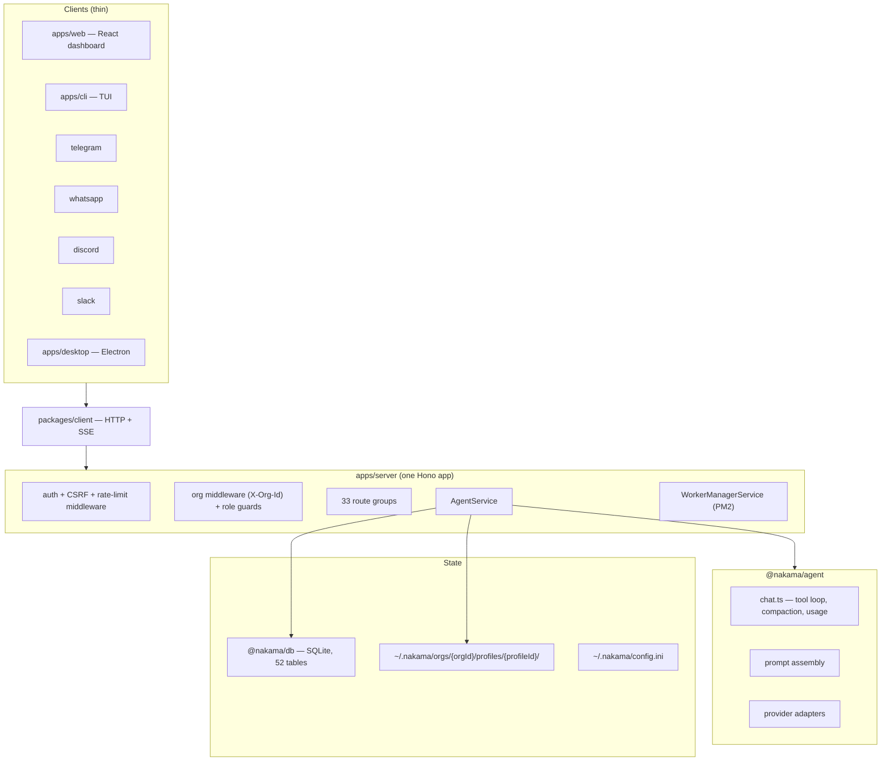

# Nakama Analysis: What Beavend Should Borrow, Compare, and Ignore

> **Subject:** [`ahmadrosid/nakama`](https://github.com/ahmadrosid/nakama) @ `12dc48a` (v0.4.59, MIT)
> **Analysed:** 2026-10-25
> **Audience:** Beavend maintainers, product, and architecture review
> **Companions:** `PRD.md`, `architecture.md`, `techstack.md`, `decisions/ADR-*.md`
> **Revised:** 2026-10-25 — v3 second-pass positioning re-audit (§1.5). v2 withdrew **channel connectors (§7.1)** and **user-facing automations/scheduling (§7.2)**; v3 applies the same filter to every remaining recommendation and withdraws the **dashboard chat-client dependencies (§8.8)**, the **workflow engine (§7.7)** and **todo state (§7.6)**, and reclassifies **Organizations (§7.9)** as control-plane. Change list in §13.
>
> **Positioning in one line:** Nakama is the app a team logs into; Beavend is the backend an app calls. One deployment serves many implementors, each with many end users, and no end user ever has an account, a session, or a screen inside Beavend. Chat channels, schedules, workflows, todo UIs and transcripts are downstream by construction, not gaps.

---

## 1. Purpose and Method

Nakama is the closest open-source neighbour to Beavend's problem space that we have analysed so far. It is a self-hosted, multi-tenant AI agent platform with providers, tools, MCP, skills, memory, channels, and a dashboard. It is **not** a competitor in the narrow sense — Nakama is an *application* built on agent primitives, while Beavend is the *backend those applications would be built on*. That difference is exactly why it is worth reading — and exactly where the first draft of this document went wrong. Nakama is a working reference implementation of the primitives Beavend's implementors will ask for; it is *also* a working implementation of a product wrapped around those primitives, and the two are easy to conflate. §1.4 is the filter that separates them, §1.5 records the second pass that caught what the first re-audit missed, and every recommendation below is read through both.

### 1.1 Method

1. Read Beavend's PRD, architecture, tech stack, and the 18 accepted ADRs to establish the baseline.
2. Cloned Nakama at `12dc48a` (default branch, v0.4.59) and ran the **graphify** pipeline over it:
   - Corpus: **1,937 files / ~2.12M words** (1,701 code, 129 docs, 103 images, 3 papers, 1 video).
   - Extraction: **AST-only** (deterministic, no LLM, no API key). The 129 docs and 103 screenshots were read directly by the analyst instead of via semantic extraction; image extraction would have bought nothing for a code/architecture review.
   - Graph: **16,744 nodes, 57,542 edges, 365 communities**.
   - Artifacts (outside this repo): `graphify-out/graph.json`, `graphify-out/GRAPH_REPORT.md`, `graphify-out/graph.html`.
3. Read the shipped documentation site (`docs/website/content/docs/*.mdx`, 46 pages), `ARCHITECTURE.md`, `THREAT_MODEL.md`, `AGENTS.md`, the SQL schema, all workspace `package.json` files, and the server/provider/tool/route source tree.
4. Compared library-by-library against `techstack.md`, then reasoned about product fit as an architect and product owner.

### 1.2 What the graph told us before reading code

The knowledge graph is unambiguous about what kind of codebase this is. Its highest-degree nodes are **not** agent-runtime abstractions:

| God node | Degree | What it means |
|---|---|---|
| `Button()` (`packages/ui`) | 462 | The UI is the gravitational centre |
| `NakamaApiError` | 447 | Error handling is a cross-cutting consumer of the HTTP contract |
| `cn()` (`packages/ui`) | 392 | Tailwind class helper uses more of the graph than any agent concept |
| `DatabaseAdapter` | 376 | One persistence interface, SQLite behind it |
| `AgentService` | 332 | The single assembly point for the whole agent runtime |
| `createSqliteMemoryAdapter()` | 186 | SQLite is the only production store |

Community structure confirms it: of the 30 largest communities, **ten are dashboard UI** (`Agent Memory UI` 359 nodes, `Discord Settings UI` 307, `Chat Capability Dialogs` 244, `Prompt Input UI` 211, `Agent Group Dialogs` 207, `Sidebar And Group Menus` 180, `Plugin Tool UI` 134, `Chat Draft And History Store` 120, …), and most of the rest are per-domain server slices (`Server Test Harness`, `Agent ACP And Questionnaire`, `DB Adapters And Core Services`, `Provider Catalog And Models`, `Knowledge Base Services`, `Telegram Channel Bridge`, `Discord Channel Bridge`, `Hono HTTP App Core`).

The five "surprising connections" the graph surfaced are all **channel-implementation + shared-contract** bridges — `TelegramImageInput → ImageAttachment`, `WhatsAppOutboundServerOptions → ChannelConfigScope`, `ChatgptProviderOptions → ChatgptOAuthCredentials` — which is the graph's way of saying: *the interesting coupling in this product is between messaging channels, provider quirks, and the shared contract type.* That is a product signal, not a code smell — but it is a signal about **Nakama's product**, not about Beavend's backend. The graph's centre of gravity is the shell that lets one human chat with a team's agents. Beavend has no such shell and should not grow one (§1.4).

Two honest caveats: 101 weakly-connected nodes are the ACP/coding-harness packages, which the graph could not tie into the main body; and several of the largest communities have cohesion below 0.03, which is expected when a community is "all the dialogs under `components/`" rather than a real module.

### 1.3 Size baseline

| Metric | Nakama |
|---|---|
| Non-test TS/TSX files | 980 |
| Test files | 550 |
| Server source files | 450 |
| Server services | 79 |
| Route registration files | 33 |
| Provider directories | 13 |
| Bundled skills | 25 |
| SQLite tables | 52 |
| Documentation pages | 46 |
| Workspaces | 13 (`apps/*`, `apps/platform/*`, `packages/*`, `packages/plugins/*`) |

### 1.4 The positioning filter

Nakama and Beavend are not the same kind of software, and the first draft drifted on precisely that point: it read Nakama's *product* features as evidence of *backend* demand, and recommended Beavend grow the same surfaces. Stated exactly:

| Dimension | Nakama | Beavend |
|---|---|---|
| What it is | The application a team uses | The backend an application calls |
| Who it serves | One team per install | Many implementors per deployment, each serving many end users |
| Who logs in | Humans, into Nakama's dashboard and its bootstrapped clients | Nobody but an admin. End users never see Beavend |
| Who owns the user relationship | Nakama (accounts, invites, sessions, channel pairing) | The implementor's identity provider (PRD §4, §7.4) |
| Who owns the conversation surface | Nakama's web app, CLI, desktop shell, channel bridges | The implementor's app — Android, iOS, KMP, Web, or whatever else they build |
| Unit of a request | One human chatting with their team's workspace | One request on behalf of one end user of one AI App, in one environment of one Project |
| Blast radius of a mistake | One team's workspace | Every tenant on the deployment |
| What "good" means | A team's daily chat habit | p95 overhead under 30 ms, cost per request, and guarantees an implementor can put in their own security review |

**The test.** Before any Nakama capability enters Beavend, ask: *can an implementor build this inside their own client or their own backend, against Beavend's API, without asking the operator to redeploy?* If yes, it is a product feature that belongs downstream, and Beavend shipping it competes with its own customers. If no — because it needs the private provider credentials, the compiled config snapshot, the policy engine, the quota ledger, the audit log, or the request path itself — it is a backend primitive, and Beavend is the only place it can live.

**Why the naive reading fails.** Nakama's features exist to make *its own* users productive. Beavend's features exist to make *other people's apps* correct. A feature that adds a surface does not only add code: it adds a credential to manage, a public endpoint to defend, a per-tenant configuration decision, an on-call page, and a policy question the operator did not ask. Beavend pays each of those once and then reaps them across every tenant on the deployment, which is why "Nakama has it and people like it" is not sufficient evidence.

Applying the test to Nakama's surface area:

| Nakama surface | What it really is | Disposition |
|---|---|---|
| Telegram / WhatsApp / Discord / Slack bridges, CLI TUI, Electron shell, agent groups, ACP and coding-harness chat | Ways for one human to talk to an agent | **Not Beavend's.** These are the implementor's clients (§7.1, §7.13) |
| Automations (cron / `runAt`), delivery targets, run history, unread counts | A scheduler plus a notification product | **Not Beavend's as a product.** Beavend owes the async *invocation* primitive; the schedule is the implementor's (§7.2) |
| Workflows, step receipts, multi-step recipes | Application-level orchestration across several requests | **Not Beavend's.** The implementor's backend sequences calls; the backend owes idempotent invocation and per-call records (§7.7) |
| Todo/planning state | A prompt convention plus a client surface | **Downstream.** The runtime owes suspension and bounded delegation, not a planning product (§7.6) |
| Chat transcript, streaming Markdown, virtualised message lists | The implementor's screen | **No.** Beavend's dashboard is an admin console (PRD §26), not a chat client (§8.8) |
| Artifacts with public share links, knowledge-base wiki authoring | End-product content features | **No.** Retrieval and attachment-by-reference, yes; link sharing and wiki authoring, no |
| Plugins that ship dashboard pages, migrations and workers | An app platform's extension system | **No.** WASM tool execution only (§7.11) |
| End-user accounts, invites, password resets, passkeys, channel pairing codes, allowlists | An identity authority | **Never.** PRD §4 non-goals. Admin passkeys are a different thing (§7.12) |
| Hosted browser farms, desktop packaging, background workers that act as a user | Infrastructure for a product | **No.** Client-side tools or implementor-owned (§8.10) |
| SSE taxonomy and resume, usage schema, model catalog, prompt bundles, compaction, memory, skills governance, MCP, guardrails, limits, caching | Contracts and guarantees on the *request path* | **Yes.** This is Beavend's job, and where Nakama's code is most worth reading |

### 1.5 Second pass: the same filter applied to v2's remaining recommendations

v2 stopped at the two loudest cases. A third pass over every recommendation finds three more surfaces that fail the test, plus one that passes only in the operator plane.

| v2 recommendation | Why it is not a Beavend primitive | v3 disposition |
|---|---|---|
| **Adopt `streamdown` + `react-virtuoso` in the dashboard (§8.8)** | Beavend's dashboard is the admin control plane — AI App config, providers, models, usage, logs (PRD §26). It has no chat transcript, no streaming assistant output and no conversation list. A transcript renderer is the implementor's client. | **Withdrawn.** |
| **Declarative workflows with step receipts (§7.7)** | An implementor's backend can sequence `/chat` calls, branch, retry and keep its own receipts. Beavend already returns a request id, per-call usage and request-log rows; a workflow engine is an application recipe, not a request-path primitive. | **Withdrawn.** Replaced by the orchestration pattern plus the async invocation contract (§7.2). |
| **`todo` planning state as a runtime feature (§7.6)** | A todo list is prompt wording plus a client surface. The runtime owes the suspension primitive (`ask_user`) and bounded delegation (`sub_agent`), not a planning product. | **Narrowed.** `ask_user` and `sub_agent` stay; todos become an implementor prompt/UI pattern. |
| **Organizations above Projects + resource publishing (§7.9)** | It passes the filter — it is operator-plane configuration, not an end-user surface — but it is not on the request path and changes nothing in the implementor's contract. It is a packaging decision for multi-project operators. | **Reclassified as control plane; defer.** |
| **Artifact previews and share links** | Already excluded in v2. The backend owes attachment transport by reference, not a content surface. | Unchanged. |

Two rules follow, and they are the ones to apply to future Nakama-like proposals:

1. **The request path is the boundary, not the clock.** If a capability exists to serve a request Beavend itself executes — model call, tool call, guardrail, limit, memory, context assembly, stream, cancellation — Beavend owns it, including the asynchronous preparation that feeds it (ingestion, indexing, compaction). If a capability is a *sequence of Beavend requests chosen by the application* or a screen the end user sees, the implementor owns it. That is why knowledge ingestion stays (§7.5) and workflows do not (§7.7).
2. **"Hard for the implementor" is not sufficient.** A workflow engine, a todo UI or a chat transcript is hard work, but it is *their* hard work, and every hour Beavend spends on it is an hour not spent on the guarantee only the backend can make: identity, quota, policy and audit across every tenant.

Everything after this section is read through the filter. Where a recommendation was withdrawn rather than revised, it says so and gives the reason.

---

## 2. What Nakama Is

> "Nakama is an AI agent platform for your team. You chat in a dashboard that feels like ChatGPT. Behind that, each agent can use tools, skills, memory, and channels — with its own identity and permissions."

Model, in Nakama's own terms:

```text
Deployment
└── Organization (tenant; the isolation boundary)
    ├── Users (own accounts: password + passkey + TOTP)
    │   └── roles: admin | member | viewer
    ├── Profile  (an agent: soul files, model, tools, skills, MCP, memory)
    │   ├── Tools      builtin | custom JS | custom Python | MCP | Composio | plugin
    │   ├── Skills     SKILL.md bundles (+ optional tool.ts/tool.py)
    │   ├── Memory     MEMORY.md (per profile) + org MEMORY.md (shared)
    │   ├── Knowledge  uploaded documents, extracted text, FTS search
    │   ├── Artifacts  files the agent produced + public share links
    │   └── Sessions   web | cli | telegram | whatsapp | discord | slack | automation
    ├── Automations    cron / runAt prompts with channel delivery
    ├── Teams (one level under a parent org, receives published resources)
    └── Plugins        npm packages adding pages + tools + migrations + workers
```

Deployment is one Bun process (optionally with PM2-managed workers), SQLite on disk, and a `~/.nakama/` directory that holds config, secrets, profiles, memory, and artifacts. Managed hosting (Nakama Cloud) wraps the same binary.

**Positioning vs Beavend.** Nakama ships the end product. Beavend ships the runtime an implementor uses to build their own end product. So the correct question is never "should Beavend have agent groups and a desktop app" — it is "which Nakama primitives prove demand for a Beavend capability, and which are Nakama's product decisions we should deliberately leave downstream."

Read the diagram again with that in mind and note what every branch of it assumes: that the human is *inside* Nakama. `Sessions` lists five chat networks plus an automation trigger; `Automations` delivers *to* those networks; a `Profile` owns artifacts with public share links and a workspace of files. Every one of those requires Nakama to hold the user relationship and the user's screen. Beavend holds the opposite end of the wire: **one deployment serves many implementors, each serving many end users, and none of those end users ever has an account, a session, or a screen inside Beavend.** That single fact invalidates a whole class of features proposed in the first draft — see §1.4, and the withdrawals in §7.1 and §7.2. A Beavend-run Telegram or Slack bot would have to answer "who is this sender?" against a user table Beavend does not have, which is exactly the identity authority PRD §4 rules out.

---

## 3. Architecture at a Glance



### 3.1 Layering rules (worth copying as an idea)

`ARCHITECTURE.md` states the invariants Beavend should also be able to state:

- **Apps may import `packages/*`; packages may never import `apps/*`.** Enforced by review, not tooling (`knip` + `oxlint` catch some of it).
- Thin clients: no agent loop outside the server. Channel apps are *transport bridges* only.
- One Hono app produces both runtime responses **and** `/openapi.json`.
- Org membership is checked before any org-scoped route; every route group registers before or after org middleware explicitly.
- Message history is durable except for one deliberately ephemeral session type.

That last set maps almost 1:1 onto Beavend's `architecture.md` §3 (planes and roles) and is a useful confirmation that "modular monolith with explicit boundaries" is the right shape for this category.

### 3.2 Where Nakama's architecture differs from Beavend, and which is right

| Concern | Nakama | Beavend | Verdict |
|---|---|---|---|
| Process model | One Bun process + PM2-managed worker processes | One static Go binary, `--role=runtime\|control\|all` | **Beavend.** No Node runtime, no PM2, no separate worker supervisor. |
| Config on the hot path | Reads SQLite/config files per request through services | In-memory immutable snapshots (ADR-002) | **Beavend.** Nakama has no snapshot layer at all; every service reads its own state. |
| Database | SQLite only (single node, single writer) | Postgres system of record + partitioned logs | **Beavend** for scale; Nakama's choice is defensible for a self-hosted single-tenant-per-org product, and it is *why* Nakama cannot do "millions of users". |
| Multi-tenancy boundary | Organization (+ one level of Teams) inside one DB | Project + Environment, key model from v0.1 | Different products. Beavend's `environment` in the key model is the stronger decision; Nakama has no environments at all (dev/prod is "run two instances"). |
| Identity | Nakama *is* the IdP (accounts, invites, passkeys, TOTP) | Delegated: validate the implementor's JWT | **Beavend.** This is a non-goal by design and the single biggest structural difference. |
| Rate limits | In-memory per-IP limiter: 600/min default, 10/min on credential routes (`rate-limit-middleware.ts`) | Redis Lua sliding window per `(project, issuer, subject, resource, window)`, fail-closed default | **Beavend** by a wide margin. Nakama has **no per-user AI quota at all**. |
| Guardrails | None found by code search (`guardrail`, `moderation`: zero hits) | Full pipeline: injection, PII, content safety, schema validation, streaming modes | **Beavend.** |
| Provider layer | 24 provider types, native SDKs per vendor, plus one OpenAI-compatible adapter | LiteLLM default behind `ProviderAdapter` + native OpenAI-compat adapter | Split decision — see §8.2. |
| Streaming | SSE with a rich typed event union + per-session subscribe/resume | SSE with a smaller event set (PRD §28.3) | **Nakama's event model is better** — see §7.3. |
| Secrets at rest | AES-256-GCM envelope in SQLite, master key from `NAKAMA_SECRETS_KEY`, `*_FILE` mount support | AES-256-GCM envelope, `KeyProvider` (env/file/KMS) | Equal. Nakama's `_FILE` convention is a nice touch worth adopting. |
| Audit | `audit_events` + `profile_change_events`, written after org middleware | `audit_log` in control plane | Equal. |
| Observability | `audit_events`, `llm_usage_stats`, `llm_usage_model_stats`, Sentry-compatible error reporting (hand-rolled envelopes), `/health` + `/v1/system/status` | OTel traces per stage, Prometheus, `slog` | **Beavend** on depth; Nakama's error-tracking integration is a cheap win — see §7.12. |
| Lint/quality tooling | `oxlint` + custom "anti-slop" rule plugins, `knip`, `jscpd`, `ultracite`, `react-doctor`, husky | `golangci-lint`/`gosec`, `govulncheck`, Trivy, fuzzing | Both serious. Nakama's **custom oxlint plugin suite** (`tools/oxlint/anti-slop/`) is an unusual and interesting investment — codebase-specific lint rules as first-class artefacts. |
| Testing | `bun test`, `msw`, recorded cassettes, colocated `.test.ts` (550 files, ~36% of source files) | `testify`, `testcontainers-go`, k6, fuzz corpus | Comparable intent. **Cassettes** for provider replay is worth borrowing (§8.2). |

---

## 4. Feature Inventory (with evidence)

Legend: ✅ implemented · ⚠️ partially · ❌ absent. "Beavend" column reflects the PRD/ADRs, not the current implementation state.

### 4.1 Tenancy, identity, and access

| Feature | Nakama | Beavend | Note |
|---|---|---|---|
| Multi-tenant container | ✅ Organization | ✅ Project | |
| Sub-tenant grouping | ✅ Teams (one level) + resource publishing | ❌ (Organizations/Teams = "Future") | §7.9 |
| Environments | ❌ | ✅ dev/staging/prod in key model | Beavend ahead |
| End-user identity | ✅ own accounts (bcrypt cost 10, passkeys, TOTP, backup codes, invites, password reset, browser sessions, CSRF, host-bound cookies) | ➖ delegated JWT/OIDC/Firebase/Supabase | Different by design |
| Admin auth | ✅ same account system + platform-admin flag | ✅ local + OIDC SSO, RBAC, audit log | Equal |
| Roles | ✅ admin / member / viewer + platform admin | ✅ owner / editor / viewer (admin side) | |
| Account disable / lockout | ✅ deployment-wide disable, "last admin" protection | ❌ | Small gap, §7.12 |
| Published shared resources | ✅ knowledge, skills, agents, tools, models published from parent to teams | ❌ | Interesting idea, §7.9 |
| Resource portability | ✅ profile packs (ZIP, secrets stripped), full workspace export/import | ✅ `beavend export/import` YAML | Beavend's config-as-code is stronger for Git; Nakama's *packs* are better for copying an agent between installs |
| Data portability | ✅ `data-portability`, `backup-restore`, whole-install ZIP | ⚠️ export by subject (PRD §25.3) | |
| Audit trail | ✅ `audit_events`, `profile_change_events` | ✅ | |
| API keys for server-to-server | ✅ `api-keys` + app-user sessions (`appUserId`) | ✅ app-scoped API keys (ADR-015) | Both needed this. Nakama's "app-user session is separate from the org user's session" is a real design subtlety Beavend will hit too |

### 4.2 AI runtime

| Feature | Nakama | Beavend | Note |
|---|---|---|---|
| Agent/AI App abstraction | ✅ Profile (soul files + model + tools + skills + MCP) | ✅ AI App | Different granularity — see §8.1 |
| Server-side prompt management | ✅ soul stack: `SOUL.md`, `STYLE.md`, `INSTRUCTIONS.md`, `MEMORY.md`, composed in a fixed order + DB `systemPrompt` fallback | ✅ versioned immutable prompts | Nakama has **no prompt versioning**; Beavend ahead |
| Layered prompt composition | ✅ 11 ordered layers (soul → skills catalog → KB catalog → org memory → user context → timezone → tool instructions → channel notes → todo → matched skills → date) | ⚠️ prompt + skills + memory | **Worth copying** — see §7.8 |
| Skills | ✅ `SKILL.md` dirs, global + profile-scoped, optional `tool.ts`/`tool.py`, `scripts:` frontmatter, `requirements.txt` venvs, catalogue + matched body injection, version history, proposals | ✅ registry, immutable versions, `always` / `on_demand` + `load_skill` (ADR-018) | Beavend's model is cleaner; Nakama has governance Beavend lacks — §8.4 |
| Memory | ✅ per-profile `MEMORY.md` (Markdown, 4096 B soft cap) + archive + org memory (2048 B injected / 8192 B live) + proposals + history/undo (50 revisions) | ✅ vector `MemoryProvider` (pgvector/HTTP/local) + threads | **Different mechanisms, both right** — §8.3 |
| Knowledge base / RAG | ✅ uploaded docs → extracted text → SQLite FTS5 lexical search; knowledge-base wiki skill; org documents | ⚠️ semantic memory only; no document ingestion pipeline specified | Gap, §7.5 |
| Context compaction | ✅ `history-compaction.ts` + provider-specific compaction estimates + thinking-token estimates | ❌ | Gap, §7.10 |
| Sub-agents | ✅ `sub_agent` — same-profile, bounded to one level, parallel when batched, live status rows, 5 min default / 10 min cap | ❌ (bounded loop only) | §7.6 |
| Todos / planning state | ✅ `todo_tools` on session metadata | ❌ (implementor prompt/UI pattern) | Not a backend primitive — §7.6 |
| Ask-user-question tool | ✅ `ask_user_question` + questionnaire state on session | ❌ | §7.6 |
| Attachments in/out | ✅ images + documents in; artifacts out | ✅ images (v0.1) | |
| Image generation | ✅ `generate_image` → OpenAI Images contract, artifacts, cost-tracked | ⚠️ via `Generator` capability (ADR-017) | |
| Audio transcription | ✅ via OpenAI / OpenAI-compatible, for Telegram voice notes | ❌ | |
| Vision fallback | ✅ `image_vision_fallback` — a text model delegates image reading to a vision model | ⚠️ routing rules (ADR-017) | Nakama's fallback-inside-a-turn is a nice complement to routing |
| Structured output / schema validation | ⚠️ an internal `response_format: json_object` provider option exists for platform tasks; no per-agent response schema and no validation/repair | ✅ `response_schema` + bounded repair | Beavend ahead |
| Guardrails | ❌ | ✅ | Beavend ahead |
| Caching | ❌ | ✅ response/tool/semantic (ADR-011) | Beavend ahead |
| Turn cancellation | ✅ abort + `chat-abort` | ✅ `/cancel` + context cancellation | Equal |
| Stream resume | ✅ `streamTurnSubscribe` + `/v1/sessions/:id/stream`, replay-aware handlers, turn-conflict detection | ❌ | **Worth copying** — §7.3 |
| Usage accounting | ✅ per-turn `ChatTurnUsage`, `llm_usage_stats`, `llm_usage_model_stats`, per-model pricing incl. **cached-input rate**, per-model custom rates, estimated-vs-measured flag for images | ✅ usage rollups; cost via LiteLLM | See §8.5 |

### 4.3 Tools and data access

| Feature | Nakama | Beavend | Note |
|---|---|---|---|
| Builtin tools | ✅ 20+ — `read_file`, `write_file`, `edit_file`, `delete_file`, `write_docx`, `save_artifact`, `search_files` (ripgrep), `web_search`, `web_fetch`, `knowledge_base_search`, `extract_document_text`, `email` (IMAP/SMTP), `bash`, `sub_agent`, `list_profile_sessions`, `read_profile_session`, `org_memory_search/list`, `propose_org_memory`, `generate_image`, `ask_user_question`, `todo`, `skill_manage`, `send_discord_artifact`, browser tools | ⚠️ HTTP/webhook/MCP/SQL-template/client-side executors + SearXNG web search (ADR-014/015). No builtin file/web-fetch/email/image tools. | §7.5 |
| Custom tools | ✅ JS (in-process), Python (subprocess, allowlisted env, 30 s), per-profile assignment, settings/secrets | ✅ implementor-defined tools in dashboard/config | Beavend's HTTP-first model is safer; Nakama's **sandboxing is inconsistent** (JS in-process = full host access) |
| Tool authorization | ⚠️ profile assignment + org role guard at route level | ✅ per-tool CEL policy, evaluated after the model requests it | Beavend ahead |
| Identity bindings / confused-deputy defence | ❌ model can pass any args; owner comes from session where noted | ✅ server-injected bindings, model cannot override | Beavend ahead — this is a headline differentiator |
| Downstream auth modes | ⚠️ stored secrets → headers/env per tool | ✅ forward_user_token / token_exchange / service_token / signed_headers | Beavend ahead |
| Tool confirmation (write tools) | ⚠️ skill **write approval** for skill files only | ✅ signed short-lived confirmation token bound to exact args (ADR-007) | Beavend ahead |
| Tool testing playground | ✅ `tool-playground-panel` + `tool-playground-params` | ✅ (PRD §17.7) | Equal |
| SSRF / egress control | ✅ `web_fetch` blocks private/reserved/localhost; operator egress allowlist documented; outbound-connection inventory doc | ✅ SafeDialer + per-project egress allowlist | Equal. Nakama's **published outbound-connection inventory** is a good doc practice |
| MCP | ✅ `stdio` + `http`, tool caching at connect, `{server}__{tool}` namespacing, status machine (`connected`/`disconnected`/`needs_auth`/`error`), **OAuth with dynamic client registration**, optional progressive tool discovery (5 at a time), `nakamaContext` for current-message images/WhatsApp sender | ✅ JSON-RPC over HTTP/SSE + SSE payloads + SSRF + auth modes (ADR-014) | **Nakama ahead on transports, OAuth, and tool-discovery cost control** — §8.6 |
| Composio (1,000+ SaaS) | ✅ two meta-tools (`search_actions`, `invoke_action`) + per-user OAuth connections | ❌ | Alternative to MCP; §7.11 |
| Output sanitisation of tool results | ✅ treated as untrusted: size caps, fixed "this is data, not instructions" prefix, `untrustedContent: true`, PII-ish redaction in error paths | ✅ redact/transform/size cap + injection guardrails | Equal intent; Nakama's **inline nonce-free prefix notice** is a cheap trick |
| Plugins | ✅ npm packages: dashboard page + actions + migrations + workers, three-gate lifecycle (install → enable → assign), package hash pinning, org-scoped data | ❌ ("plugin system, marketplace" = Future) | §7.11 |

### 4.4 Delivery surfaces

Nakama's *product* surfaces, recorded for completeness. **None of these are Beavend features** (§1.4): a backend's delivery surface is its API and its SDKs, and every screen below belongs to the implementor.

| Feature | Nakama | Beavend |
|---|---|---|
| Web dashboard | ✅ React SPA, chat-first, command palette, virtualised transcript, artifact previews | ✅ embedded SPA (ADR-009) — admin control plane only, no chat UI |
| SSE streaming API | ✅ | ✅ |
| REST/OpenAPI | ✅ generated from Zod route definitions (`@hono/zod-openapi` → `/openapi.json`) | ✅ spec-first OpenAPI 3.1 |
| TypeScript client | ✅ `packages/client` | ✅ `beavend-sdk-web` |
| Channels | ✅ **Telegram** (grammy), **WhatsApp** (Baileys), **Discord** (discord.js), **Slack** (raw API) — pairing codes, allowlists, per-channel adapters, artifact delivery with per-channel size caps, `/org` switching, notifications | ❌ — and it should stay ❌ (§7.1) |
| CLI | ✅ TUI (`@earendil-works/pi-tui`), `apps/cli` | ❌ (admin `beavend` CLI only) |
| Desktop | ✅ Electron + auto-update | ❌ |
| Automations | ✅ cron / `runAt` / manual, timezone, profile binding, delivery to Telegram/Discord/WhatsApp/email, run history + unread counts, worker heartbeat | ❌ |
| Workflows | ✅ plugin: 5 step kinds (`tool`, `compare`, `assert`, `template`, `summarize`), `{{steps.x.value}}` refs, receipts per step, run history | ❌ — orchestration is the implementor's backend (§7.7) |
| Agent groups | ✅ 2–12 agents in one chat, `@handles`, `@all`, agent-to-agent hand-off with a hop cap, private threads on a message | ❌ |
| ACP chat agents | ✅ Claude / Codex run the profile's chat turn over the Agent Client Protocol | ❌ |
| Coding-agent harnesses | ✅ spawn Claude Code / Codex / OpenCode / Pi / Cursor with provider passthrough env | ❌ |

### 4.5 Operations

| Feature | Nakama | Beavend |
|---|---|---|
| Packaging | Bun + Docker + `docker compose`, one container, ~200 MB idle | Go binary + compose (postgres, valkey, litellm, searxng) |
| Worker orchestration | PM2 (optional) | Not needed |
| Scheduled work | Cron polling worker (5 min default reload) | ❌ |
| Backup / restore | Whole-install ZIP, per-org workspace ZIP, plugin-data snapshots, restore leaves plugins disabled | Config export/import only |
| Error tracking | Sentry/GlitchTip/Bugsink/Rustrak DSN, envelope POST, disk-queued on crash, aggressive scrubber, `DO_NOT_TRACK` | OTel only |
| Health | `/health`, `/v1/system/status`, worker heartbeats | ✅ |
| Deployment hardening guide | ✅ Caddy/Nginx, private port, egress limits, data-root perms, secrets handling, verification commands | ⚠️ implied |
| Threat model | ✅ `THREAT_MODEL.md` — assets, trust boundaries, STRIDE, residual risks, reviewed revision pinned | ⚠️ PRD §12 only |

---

## 5. Library Inventory and Comparison

### 5.1 Nakama's full dependency surface

**Root:** `bun` runtime · `@biomejs/biome` + `ultracite` + `oxlint` (with custom plugins) · `knip` · `jscpd` · `react-doctor` · `husky`.

| Workspace | Dependencies |
|---|---|
| `apps/server` | `hono`, `@hono/zod-openapi`, `zod`, `openai`, `@anthropic-ai/sdk`, `@google/genai`, `@openrouter/sdk`, `@modelcontextprotocol/sdk`, `@composio/core`, `@agentclientprotocol/sdk`, `@agentclientprotocol/claude-agent-acp`, `@agentclientprotocol/codex-acp`, `@simplewebauthn/server`, `pm2`, `pacote` (npm fetch), `tar`, `fflate`; dev: `msw` |
| `packages/core` | `zod`, `@firecrawl/anydoc` (doc text extraction), `@vscode/ripgrep`, `croner`, `docx` (Word generation), `fflate`, `imapflow`, `mailparser`, `nodemailer`, `marked`, `node-html-markdown`, `robots-parser` |
| `packages/agent` | `zod`, `@nakama/core` — **no LLM SDK**; provider SDKs stay in the server |
| `packages/db` | own SQLite adapter (`bun:sqlite`), `.sql` schema + migrations |
| `packages/client` | zero deps beyond core types |
| `apps/web` | `react`, `react-dom`, `react-router-dom`, `@tanstack/react-query`, `zustand`, `tailwindcss`, `@base-ui/react`, `hugeicons-react`, `cmdk`, `streamdown` (+ cjk/code/math/mermaid), `react-virtuoso`, `@leeoniya/ufuzzy`, `qrcode.react`, `croner`, `hashvatar`, `@simplewebauthn/browser` |
| `packages/ui` | `@base-ui/react`, `class-variance-authority`, `tailwind-merge`, `cmdk`, `hugeicons-react` |
| `packages/plugins/*` | plugin-local; migrations + UI + workers |
| `apps/platform/telegram` | `grammy` |
| `apps/platform/whatsapp` | `@whiskeysockets/baileys` |
| `apps/platform/discord` | `discord.js` |
| `apps/platform/slack` | none (raw HTTP) |
| `apps/platform/automation` | `croner` |
| `apps/cli` | `@earendil-works/pi-tui`, `@crosscopy/clipboard`, `@leeoniya/ufuzzy` |
| `apps/desktop` | `electron`, `electron-builder`, `electron-updater` |

Notable **absence**: no Anthropic/OpenAI SDK duplication in the agent package, no ORM, no Redis, no vector DB, no job queue, no auth SaaS.

### 5.2 Layer-by-layer comparison and recommendation

| Layer | Nakama | Beavend (current plan) | Recommendation |
|---|---|---|---|
| Runtime | Bun + TypeScript | Go (ADR in `techstack.md` §3) | **Keep Go.** Nakama's Bun advantage is one language with the dashboard; its cost is PM2 processes, a Node-ish base image, and no true multi-process model. Beavend's workload is I/O-bound proxying — Go is the better fit and the single-binary story is a real differentiator for self-hosters. |
| HTTP + contract | `hono` + `@hono/zod-openapi` (route definition *is* the OpenAPI doc) | `chi` + hand-written OpenAPI 3.1 | **Keep spec-first**, but adopt Nakama's *guarantee*: add a CI job that diffs the running router against `api/openapi.yaml` so the spec can never silently drift. Add `oapi-codegen` for Go types and keep `openapi-typescript` for the dashboard. |
| Validation | `zod` | `santhosh-tekuri/jsonschema` + CEL | **Keep.** zod is excellent for TypeScript handlers; Go has no equivalent single answer, and Beavend needs JSON Schema anyway for tool schemas and `response_schema`. Do not add `go-playground/validator` on top. |
| Database | SQLite, own adapter interface, hand-written migrations | Postgres + `pgx` + `sqlc` + `goose` | **Keep.** SQLite is why Nakama cannot be horizontally scaled and why "millions of users" is out of reach. Nakama's `DatabaseAdapter` interface is, however, a good shape — Beavend already achieves the same via `sqlc`-generated queries. |
| Vectors / RAG | SQLite FTS5 lexical only | `pgvector` | **Keep pgvector, add lexical.** See §7.5 for hybrid retrieval (Postgres FTS + `pg_trgm` + RRF), which needs no new dependency. |
| Cache / counters | none | Valkey/Redis + Lua (ADR-006/011) | **Keep.** Confirmed as a differentiator. |
| Provider access | Native SDK per vendor: `openai`, `@anthropic-ai/sdk`, `@google/genai`, `@openrouter/sdk`, plus one OpenAI-compatible adapter and OAuth subscription modes | LiteLLM default behind `ProviderAdapter` + native OpenAI-compat adapter (ADR-005) | **Keep, but fix the gap LiteLLM leaves.** Nakama proves demand for: (a) per-provider *native* quirks (Anthropic thinking-block replay, OpenAI Responses API, pause continuation) and (b) non-API-key auth (ChatGPT Plus, SuperGrok OAuth). Recommend: keep LiteLLM for breadth, keep the native compat adapter for volume, and add `adapter: native` for **OpenAI Responses API** and **Anthropic** only if real implementors ask. Do **not** build 24 vendor adapters. |
| Provider replay testing | `msw` + recorded cassettes (`apps/server/src/testing/cassettes`) | `testcontainers` + mock provider | **Borrow cassettes.** A deterministic recorded-provider harness is the single cheapest way to make provider quirks testable. Implement as recorded HTTP fixtures replayed by a `httptest` server. |
| Streaming | SSE + typed `StreamEvent` union + turn subscribe/resume + conflict detection | SSE + smaller union | **Upgrade the union** (§7.3). |
| Agent loop | `packages/agent/src/chat.ts` (1,441 lines) + `tool-loop.ts` + `history-compaction.ts` | `internal/runtime/agent` bounded loop + stages | **Keep stages**, borrow compaction and the `ask_user` / bounded `sub_agent` primitives. Todos are a prompt/client pattern, not a runtime primitive (§7.6). |
| Skills | On-disk `SKILL.md` dirs + DB sync + `skill_versions` | Postgres registry, immutable versions, snapshot-compiled (ADR-018) | **Keep registry, borrow portability and governance** (§8.4). |
| Memory | Markdown files + `MemoryBackendService` + Supermemory plugin | `MemoryProvider` interface (pgvector/HTTP/local) | **Keep interface; add a Markdown/document memory class** (§8.3). |
| MCP | `@modelcontextprotocol/sdk`, stdio + HTTP, OAuth DCR, tool caching + discovery | Custom JSON-RPC over HTTP/SSE (ADR-014) | **Adopt the official Go SDK** (`github.com/modelcontextprotocol/go-sdk`) rather than a hand-rolled JSON-RPC client, and add `stdio` + OAuth DCR. Supersedes part of ADR-014; see §8.6. |
| Scheduling | `croner` inside a PM2 worker that polls schedules every 1–1440 min | none — and none needed | **Do not ship a user-facing scheduler** (§7.2). A schedule needs a user, a timezone, a preference and a delivery target, none of which Beavend owns (PRD §5). The implementor's own cron calls the async invoke endpoint. What Beavend *does* need is durable internal jobs for work it owns: knowledge ingestion (§7.5), compaction (§7.10), and operator maintenance. Use **River** (`github.com/riverqueue/river`) on the existing Postgres — transactional enqueue, retries, unique jobs, no new infrastructure — and avoid a poll-and-diff scheduler entirely. |
| Workflows | Plugin, hand-rolled step runner with receipts | none | **Do not build a workflow engine.** An implementor's backend can sequence `/chat` calls, branch, retry and keep receipts; Beavend already returns request ids and per-call usage/log rows. The backend's job is one idempotent, quota-accounted request at a time (§7.7). |
| Channels | Telegram `grammy`, WhatsApp `@whiskeysockets/baileys`, Discord `discord.js`, Slack raw HTTP | none | **Do not build them** (§7.1). A bot bridge is a *client*, and the implementor already runs a backend for it. Beavend ships the primitives such a bridge needs — bot identity via key policy, thread addressing by `external_ref`, idempotent invocation, resumable streaming, attachments by reference — and documents the pattern. No vendor SDKs, no webhook ingress, no pairing codes. Keep warning implementors off unofficial WhatsApp bridges (§7.1.1). |
| Dashboard | React 19 + `react-router-dom` + `@tanstack/react-query` + `zustand` + Tailwind + `@base-ui/react` + `streamdown` + `react-virtuoso` | React + Vite + TanStack Query/Router + Tailwind + shadcn/ui (Radix) + Recharts + Monaco | **Keep our admin stack; borrow nothing from Nakama's chat client.** `streamdown`, `react-virtuoso`, `cmdk` and the transcript patterns solve an implementor's chat UI, not an admin console (§8.8). |
| Forms / API client | Zod-inferred types, no codegen | React Hook Form + Zod, `openapi-typescript` | **Keep.** Spec-generated types are what makes three SDKs tractable. |
| Custom code execution | JS imported **into the server process**; Python as a subprocess with an allowlisted env | None yet ("plugin / custom executor") | **Use WASM, not in-process JS or host subprocesses.** `github.com/tetratelabs/wazero` gives a pure-Go, no-cgo sandbox with fuel metering, memory limits, and no host access. Gas/fuel limits map directly onto Beavend's quota model. Host `bash`-style tools must stay out of scope — Nakama's own docs concede that "Host Bash is unrestricted by Nakama… checking `cwd` does not isolate commands." |
| Admin auth (MFA/passkeys) | `@simplewebauthn/server` + `@simplewebauthn/browser`, TOTP, backup codes | local + OIDC SSO | **Adopt passkeys + TOTP for admin accounts** with `github.com/go-webauthn/webauthn` and `github.com/pquerna/otp`. This is small, high-trust work that self-hosters notice. |
| Error reporting | Hand-rolled Sentry envelopes (deliberately zero-dependency), disk-queued, aggressive scrubber | OTel export | **Prefer OTel→OTLP first.** If a Sentry-compatible DSN is offered, use `github.com/getsentry/sentry-go` (it speaks OTel) instead of re-implementing envelopes — but copy Nakama's *scrubber* rules verbatim, they are well-considered. |
| Web search across providers | Provider-hosted by default (3 vendor code paths) with an Exa/Firecrawl/Serply override; fixed 5 results / 800 chars / 30 s | SearXNG only (ADR-015) | **Keep SearXNG as the default and add a `SearchBackend` interface** so an implementor can swap in Exa/Firecrawl/SearXNG/any JSON endpoint. Nakama's own documentation lists three provider-imposed limitations of renting search; the interface costs one file per backend and removes them. Full comparison in §8.10. |
| Web page reading | `node-html-markdown` + `robots-parser` + DNS blocklist, 1 MB / 30 s / 5 redirects | none | **Add it.** Go picks: `github.com/JohannesKaufmann/html-to-markdown` + `github.com/go-shiori/go-readability`. Reuse the existing `SafeDialer`, honour robots.txt, and cache under ADR-011 at `scope: shared` — none of which Nakama does. §8.10. |
| Doc extraction | `@firecrawl/anydoc`, `docx`, `marked`, `node-html-markdown`, `robots-parser` | none specified | **Go picks:** `github.com/ledongthuc/pdf` (PDF text), a small `word/document.xml` reader for `.docx` (or `github.com/nguyenthenguyen/docx`), `github.com/xuri/excelize/v2` for sheets, `github.com/JohannesKaufmann/html-to-markdown` + `github.com/go-shiori/go-readability` for HTML. **Avoid `unidoc/unipdf`** — AGPL/commercial licensing conflicts with Apache-2.0. |
| Email tool | `imapflow` + `mailparser` + `nodemailer` | none | **If** added: `github.com/emersion/go-imap/v2` + `github.com/wneessen/go-mail`. Low priority; defer. |
| Cron parsing | `croner` | none | `github.com/robfig/cron/v3` for validation/`nextRunAt` preview only; execution is owned by the job queue. |
| CLI | `pi-tui` terminal UI | none | **Skip the TUI.** `beavend migrate`, `beavend export/import`, `beavend token` are enough; a chat TUI duplicates the SDKs' job. |
| Desktop | Electron | none | **Skip.** Contradicts "thin clients, server-owned runtime." |
| Lint / quality | `oxlint` + **custom AST rule plugins** in-repo, `knip`, `jscpd`, `react-doctor` | `golangci-lint`, `gosec`, `govulncheck` | Keep ours; consider one page of *project-specific* lint rules as a documented artefact (the idea, not the tool). |
| Testing | `bun test`, `msw`, cassettes, live `*.llm.test.ts` tests separated from unit tests | `testify`, `testcontainers`, k6, fuzz | **Borrow the `.llm.test.ts` convention**: a naming suffix that marks tests that hit a real provider, excluded from default CI. Cheap and very effective. |

---

## 6. Where Nakama Validates Beavend

These are worth recording because they de-risk decisions already made:

1. **One binary / one process to run.** Nakama's PM2 worker supervisor is the single most operationally fragile part of its design (worker heartbeats, poll intervals, "if the worker is down, scheduled runs do not fire"). Beavend's `--role=all` single binary is the right call.
2. **Config-as-code is a real feature, not a checkbox.** Nakama has no versioning of prompts, policies, or tools; profile soul files are the only Git-friendly surface. Beavend's immutable versioned resources + YAML export/import is a genuine competitive gap in Nakama's favour of us.
3. **Per-user limits and guardrails are unmet demand.** Nakama has zero quota enforcement and zero guardrails, and its docs repeatedly warn operators to "assign host Bash only to trusted profiles" and "approve only code you trust." That is the exact problem Beavend's policy engine, limit engine, confirmation tokens, and guardrails exist to solve. This is our strongest positioning story against this class of product.
4. **Delegated identity is a feature, not a limitation.** Nakama maintains accounts, sessions, invites, password resets, passkeys, TOTP, backup codes, CSRF, and host-bound cookies. That is an enormous amount of security-critical surface Beavend does not have to own — and the PRD's §7.4 (revocation out of scope) is defensible because the *implementor's* IdP owns it.
5. **Tool identity bindings matter.** Nakama's tools take `profileId`/`recipientId`-style arguments from the model and validate access afterwards. Beavend's "identity comes only from the validated token, never from model output" is a materially stronger guarantee and should be marketed as such.
6. **Stateless + Postgres is correct for the stated scale target.** Nakama is architecturally single-node. There is no path from SQLite + PM2 to 15,000 concurrent SSE streams without a rewrite.
7. **A backend is defined by what it refuses to own.** Nakama needs four channel bridges, a CLI, a desktop shell and a plugin runtime because it is where humans go. Beavend's equivalent investment is one contract and three SDKs. The first draft mistook the first list for a roadmap; the correct reading is that every surface Nakama had to build is a surface Beavend gets to hand to the implementor — provided the contract underneath makes it a weekend of work (§1.4, §7.1).

---

## 7. Feature Decisions: Add, Narrow, or Withdraw

Ordered by expected value per unit of risk. Each entry states the primitive (not the product), the Beavend-shaped design, the library recommendation, the risk, and what it supersedes or amends.

The entries marked **Withdrawn** are the product surfaces earlier drafts mistook for primitives: channels and automations in v2, and workflows and todo state in v3. The dashboard chat-client libraries are withdrawn in §5.2 and §8.8. Each withdrawal states the primitive that replaces it.

### 7.1 Priority 1 — ~~Channel Connectors~~ **Withdrawn.** The backend owes the primitives a bridge needs

**What the first draft said, and why it was wrong.** It called channel connectors "the largest genuine capability gap" and specified four bot integrations as a control-plane resource, with a paired-identity allowlist and per-channel message rendering. Measured against §1.4, that recommendation fails three ways.

1. **It makes Beavend an identity authority.** The proposed design derives `Identity{issuer: "channel:telegram", subject: <telegram user id>}` from a pairing code. Pairing an external account to a Beavend identity *is* account linking: Beavend would hold the mapping between a chat handle and a person, decide whether an unpaired sender is allowed, and own the relationship across unpaired, blocked and re-paired states. That is PRD §4 and §7.4 — the two non-goals the whole architecture is built around. It also has to guess the implementor's user model, which Beavend cannot know.
2. **It multiplies the ingress surface by the tenant count.** One deployment would carry a bot credential and a public webhook URL per channel, per AI App, per environment, per Project. Each is a secret to store, an endpoint to signature-verify, a rate-limit and abuse surface, and a page somebody is on call for — and all of it sits inside one operator's blast radius. A backend serving many implementors is the worst possible place to add per-tenant public endpoints.
3. **It re-implements a client the implementor already runs.** The implementor has an app backend. A Telegram handler that calls `POST /v1/apps/{id}/stream` and replies is a day of work in their own language, wired into their own IdP and their own user table, where the pairing question actually has an answer. Beavend doing it means four vendor SDKs, four credential models, four media pipelines, four message-rendering rules and a permanent maintenance tail — for a capability the implementor owns better.

So channels are a **client pattern**. The document's job is to make that pattern cheap to implement, not to ship it.

**What Beavend owes instead.** A bot bridge is a *server-side* client, and server-side clients need five things the current API does not give them cleanly. Each is a contract addition measured in days, not a new subsystem:

| A bridge needs | What Beavend should provide |
|---|---|
| To call as itself on behalf of a user it has already authenticated | **An optional `may_assert_subject` policy on the app-scoped API key (ADR-015)**, naming the subject and claim set the key may assert. The identity then arrives in the *validated credential*, never from model output — the guarantee holds, and the one narrowing (a trusted implementor backend may name a subject) is written down instead of implied |
| To continue a conversation it holds no local state for | **`external_ref` on server-side threads**: an opaque implementor-supplied key, unique per `(project, env, app)`, with create-or-continue semantics and `409` on conflicting reuse. Today every bridge invents its own thread-mapping table |
| Retried deliveries not to double-charge or double-execute | **An `Idempotency-Key` on invoke/stream**, replaying the original run and its usage instead of starting a second one. Chat platforms retry webhooks; with write tools that is a correctness bug, not a UX bug |
| To reattach after its own process restarts mid-turn | **Resumable streaming with `Last-Event-ID`** — the §7.3 recommendation, but with a server as the consumer, which makes it a stronger requirement rather than a nicer one |
| To move media without the stream | **Attachments by reference**: upload once, pass an id, fetch an output attachment by id. Keeps binaries out of SSE and out of the token budget |

**Explicit non-goals:** no bot tokens, no webhook ingress, no pairing codes or allowlists, no channel-specific message rendering, no per-channel size caps, and no WhatsApp integration of any kind. When an implementor asks to build one, point them at the table above and at §7.3.

**7.1.1 Still true: do not use an unofficial WhatsApp bridge.** `@whiskeysockets/baileys` implements the WhatsApp Web multi-device protocol by reverse engineering it. It violates WhatsApp's Terms of Service, the linked number can be banned without appeal, and it is a permanent maintenance and legal liability. That was a reason not to ship it inside Beavend; it is now a **documentation warning for implementors** who build a bridge themselves — the official **WhatsApp Business Cloud API** is two documented HTTPS endpoints plus a signature check, and it is the only variant we will describe favourably.

**Risk / effort.** Low. Five small contract additions (key policy field, `external_ref`, `Idempotency-Key`, resumable stream, attachment references), no new subsystem. No new ingress plane, no new credential types, no new vendor dependencies, no new permanent maintenance surface.

**Supersedes:** the first draft's §7.1 and its channel-connector ADR. **Amends:** ADR-015 (key policy gains `may_assert_subject`), ADR-012 (thread gains `external_ref`), PRD §28.1 — and the architecture's plane diagram, which notably does **not** gain an ingress plane.

**If an implementor ignores this and builds a bridge anyway**, the libraries they will reach for: Telegram `github.com/go-telegram/bot` (zero-dependency, webhook + long-poll), Discord HTTP interactions before `discordgo` (no gateway socket, no reconnect state machine), Slack `github.com/slack-go/slack` (signature verification, Block Kit). Those are their dependencies, in their repo — not ours.

---

### 7.2 Priority 1 (revised) — Async invocation and an internal job queue. Not user-facing scheduling

**What the first draft said, and why it was wrong.** It recommended Beavend ship durable automations: cron triggers, `runAt`, timezone handling, delivery targets, run history, unread counts. The *product* half of that fails the filter. A schedule needs a user to run as, a timezone to run in, a preference about whether they wanted it, and somewhere to deliver the result — and Beavend owns none of those, by design (PRD §5: it does not own the application's users or their data). It cannot even answer the question the first draft raised in §12 — *whose quota does the run burn* — because the user table it would key on belongs to the implementor. Nakama can do this only because Nakama **is** the user's application.

**What survives is the harder half, and it is more urgent than the original framing admitted.** Beavend has long-running work of its own on day one:

- a mobile client that backgrounds mid-turn and cannot hold an SSE stream open indefinitely;
- knowledge ingestion (§7.5), which must extract, chunk and embed asynchronously;
- compaction (§7.10) and any other multi-call maintenance work;
- operator maintenance: snapshot compilation, partition rotation, cache warming, re-embedding after a model change.

That is async **invocation**, a run handle, and a durable internal queue. It is not a scheduler, and it is not a dashboard page called "Automations".

**Beavend-shaped design.**

```text
POST /v1/apps/{id}/invoke            (or /chat honouring `Prefer: respond-async`)
  Idempotency-Key: <implementor-supplied>
  → 202 { run_id, thread_id?, status_url, stream_url }

GET  /v1/runs/{run_id}               → status, usage, terminal output or error code
GET  /v1/runs/{run_id}/stream        → replay from Last-Event-ID (§7.3)
POST /v1/runs/{run_id}/cancel        → the same cancellation path as the sync route
```

Rules, in the order they will bite:

1. **A run is the same pipeline.** Same stage chain, same identity resolution, same policy, same limits, same guardrails, same usage rows. Asynchrony is a transport mode, not a second runtime. This is the corrected form of the first draft's "no parallel runtime" invariant, and it belongs to the invocation path rather than to channels.
2. **Identity comes from the credential, never the request body** — with exactly one exception, the trusted-backend case in §7.1. A run started with an end-user token carries that user; a run started under an app-scoped key carries the subject that key is permitted to assert, and nothing else.
3. **A run is operational data, not application data.** Bounded TTL on the event buffer and on the terminal result; no durable transcript unless the Project opted into server-side threads (PRD §5). Do not let the run store quietly become a copy of the implementor's conversation history.
4. **Idempotency belongs to the invocation, not to a run table.** Same key and same body returns the original run; same key with a different body is a `409`. That is what makes a retried delivery safe against a write tool.
5. **Cancellation is the existing cancellation**, propagated through the same `context.Context`, and it must release reserved quota rather than leaking it.

**Library recommendation.** **River** (`github.com/riverqueue/river`) on the existing Postgres, for the jobs Beavend itself owns. Transactional enqueue with `pgx` — a job cannot run before its transaction commits and cannot be lost — plus retries with backoff, unique jobs, scheduled one-offs, and jobs visible in SQL, with no new infrastructure. Because nothing user-facing depends on periodic jobs, River's Pro-only *durable periodic* feature stops mattering; drop it from the decision rather than designing around it.

| Option | Verdict |
|---|---|
| **River** (Postgres) | **Recommended.** Correct shape for internal work: transactional, observable, retryable, same database as the system of record. No new service to operate. |
| `hibiken/asynq` (Redis) | Fallback for installs that refuse Postgres write capacity; jobs then live outside the system of record, and Redis-only installs are the documented degraded mode. |
| `robfig/cron/v3` | **Not needed.** It was only required to parse user-supplied cron expressions, and there are none. |
| Kubernetes `CronJob` | Rejected: contradicts `docker compose up` self-hosting. |
| Temporal | Not needed. Workflow orchestration is the implementor's backend (§7.7); Beavend's job is one well-instrumented request at a time. |

**Risk / effort.** Medium. One run resource, one queue table, one worker loop, TTLs, and an idempotency index. The subtle work is the interaction with quota reservation and cancellation — the same work the synchronous path already does, now with a lifetime it does not control.

**New ADR:** "Async invocation with run handles, idempotent invocation, and an internal Postgres job queue." Not "automations".

---

### 7.3 Priority 1 — Richer SSE event model and stream resume

**Why.** This is the cheapest high-impact change in the whole document. Beavend's SSE union is `delta`, `tool_call`, `confirmation`, `usage`, `error`, `done` (PRD §28.3). Nakama's is materially better, because it was designed against a real chat UI:

```ts
type StreamEvent =
  | { type: "chunk"; delta: string }
  | { type: "thinking"; delta: string }
  | { type: "tool_input_delta"; toolCallId; tool; delta; accumulatedArguments? }
  | { type: "tool_start"; toolCallId; tool; input }
  | { type: "tool_end"; toolCallId; tool; result; images? }
  | { type: "todos_updated"; todos }
  | { type: "questionnaire_updated"; questionnaire }
  | { type: "sub_agent_activity"; parentToolCallId; label }
  | { type: "usage"; usage }
  | { type: "done"; reply; contextUsage?; usage? }
  | { type: "error"; error; usage? }
```

**Recommended Beavend union (additive, versioned):**

```text
event: delta        { text }                              # existing
event: reasoning    { text }                              # NEW: thinking/CoT deltas
event: tool_start   { id, name, args }                    # NEW (splits today's tool_call)
event: tool_delta   { id, name, args_partial }            # NEW: streamed tool args
event: tool_end     { id, name, status, latency_ms }      # NEW: result stays out of the stream
event: confirmation { tool, args, token }                 # existing
event: usage        { input_tokens, output_tokens, cached_input_tokens, cost_usd }
event: error        { code, message, retryable }
event: done         { request_id, finish_reason }
```

Three specific lessons:

- **Never send tool *results* over the stream.** Nakama does (`tool_end` carries `result`). For Beavend that is a data-exfiltration surface: tool output may contain implementor business data, and it may be large. Send status and a `result_ref` instead; put results in the request log (redaction rules apply) or nowhere.
- **Streaming tool arguments (`tool_delta`)** is what makes a UI feel alive and is nearly free — the provider already streams them.
- **Resume.** Nakama has `GET /v1/sessions/:id/stream` (`streamTurnSubscribe`) with replay-aware handlers and turn-conflict detection, so a reconnecting mobile client does not lose a half-finished turn. Beavend's mobile-first SDK story cannot do this today. Because ADR-012 already gives us thread storage, add: buffer the last N events per in-flight turn in Redis (ADR-011's store), keyed by `(project, env, request_id)`, with `Last-Event-ID` resume. That is a small addition to an existing store.

**Library recommendation.** None — this is contract design. Add an `api/sse-events.md` schema file next to `openapi.yaml` so the three SDKs codegen against it, and add a conformance test per SDK.

**Risk / effort.** Low. **This is the highest value-per-line-of-code item in the document.**

---

### 7.4 Priority 1 — Model catalog with capabilities and pricing

**Why.** Beavend exposes logical models mapped to deployments (PRD §14) and takes cost from LiteLLM (PRD §37). Two problems follow: (a) the dashboard cannot render a model picker with capability metadata, and (b) cost is unavailable or fabricated when a custom `ProviderAdapter` bypasses LiteLLM — which the PRD itself lists as open question §40.7. Nakama solved both with a per-model catalog carrying capability flags and **per-model pricing including a cached-input rate**, plus operator-entered rates for models it does not recognise.

**Beavend-shaped design.**

```yaml
logical_model: fast
deployments:
  - provider: openai
    model: gpt-x
    capabilities: { input: [text, image], output: [text], context_window: 400000, tools: true, cache: true }
    pricing:      { input_usd_per_mtok: 1.25, cached_input_usd_per_mtok: 0.31, output_usd_per_mtok: 10 }
    source: catalog            # catalog | operator | provider_reported
```

Rules worth stating explicitly:

- `capabilities` are used for *validation and UI* only, never for routing — same conclusion as ADR-017 §3, now independently corroborated.
- `pricing` populates cost when the provider reports usage but not cost. When the adapter reports real cost, that wins. When neither exists, record `cost_source: unknown` and show a blank — never a default ($1/$3 like Nakama's `DEFAULT_PRICING`) presented as fact.
- Include `cached_input_*`. Prompt caching is the single biggest cost lever for chat workloads and is invisible in a two-rate model.
- Operator overrides are per `(logical_model, deployment)`, and they must be exported in config-as-code so Git is the source of truth.

**Library recommendation.** No dependency. Ship a static embedded catalog (JSON, refreshed per release) + `models.dev`-style import as a convenience. Do not fetch a catalog at startup — self-hosted installs must boot offline.

**Risk / effort.** Low-medium. One table, one importer, dashboard pickers.

---

### 7.5 Priority 2 — Knowledge ingestion and hybrid retrieval

**Why.** Beavend's memory (ADR-012) is *semantic recall of facts*, not *retrieval over documents*. Nakama's knowledge base is the other half: upload a document, extract text, search it. Implementors building "chat with my docs" will hit this immediately, and the PRD currently has no ingestion story beyond "attachments with TTL."

**Design.**

```text
POST /v1/admin/apps/{id}/knowledge        # multipart, TTL optional
  → store object (temp storage, ADR-011 rules)
  → extract text (bounded, async job)
  → chunk (structure-aware: headings first, then tokens with overlap)
  → index: Postgres FTS (tsvector)  +  pgvector embedding
  → status: pending | extracting | indexing | ready | failed

Retrieval: hybrid
  lexical  = websearch_to_tsquery + ts_rank_cd      (exact terms, IDs, error codes)
  semantic = pgvector cosine over chunk embeddings  (paraphrase, synonyms)
  fused    = Reciprocal Rank Fusion (k=60), then rerank/cut by token budget
```

Why hybrid and not vector-only: lexical search wins decisively on identifiers, names, and codes — the most common RAG query in a developer product — and it degrades gracefully when no embedding provider is configured. RRF needs no new dependency and no tuning.

**Library recommendation.**

| Concern | Nakama | Beavend |
|---|---|---|
| Extraction | `@firecrawl/anydoc` | `github.com/ledongthuc/pdf`, small `.docx` XML reader, `github.com/xuri/excelize/v2`, `github.com/JohannesKaufmann/html-to-markdown` + `github.com/go-shiori/go-readability`. Optional sidecar (Tika/Apache) for exotic formats — out-of-process, so no license contamination |
| Chunking | own | own (structure-aware) |
| Lexical | SQLite FTS5 | Postgres FTS + `pg_trgm` (no new dep) |
| Semantic | none (Supermemory plugin) | `pgvector` (already chosen) |
| Fusion | n/a | RRF in Go (no dep) |

**Avoid:** `unidoc/unipdf` (AGPL/commercial) in an Apache-2.0 distribution.

**Risk / effort.** Medium. The extraction-quality tail is long; ship PDF/TXT/MD first, cap size (Nakama caps 20 MB upload, 256 KB extracted text — both reasonable), and never OCR in v1.

---

### 7.6 Priority 2 — Human-in-the-loop suspension and bounded delegation (`ask_user`, `sub_agent`)

**Why.** Nakama ships three small tools, and only two are backend primitives. `ask_user_question` and `sub_agent` change what the runtime can do *inside a turn*: one suspends the loop for a human answer, the other delegates a bounded piece of work under the same identity and budget. `todo` is different — it is prompt wording plus a client surface, and an implementor can add it without Beavend.

| Primitive | Design for Beavend | Notes |
|---|---|---|
| `ask_user` | The loop suspends and emits an SSE `question` event carrying a **signed, single-use continuation token**; the client posts `/v1/apps/{id}/answer`. | **Reuse ADR-007's existing confirmation mechanism precisely.** Nakama stores questionnaire state on the session row; Beavend already has the better primitive (encrypted Redis state, 5-min TTL, no sticky sessions) and should not invent a second suspension mechanism. |
| `sub_agent` | Bounded delegation: same AI App, one level (no nesting), max depth from config, own token budget drawn from the parent request, results returned as **untrusted tool output**. | Deliberately do **not** copy Nakama's "parallel when the model batches them" without a cap: N parallel sub-agents × M loop depth is an unbounded cost surface, and Beavend has a quota engine that must be able to account for it. Reserve tokens up front against the parent's budget. |
| ~~`todo`~~ | **Not a runtime primitive.** A planning checklist is prompt wording plus whatever the implementor's client renders. Beavend can document the prompt pattern, but it should not add a `todos` resource, a `todos_updated` event or a thread field for it. | Removed in v3. If implementors ask for a scratchpad, the answer is a tool with a schema, not a product surface. |

**Risk / effort.** Low each. `ask_user` and `sub_agent` are v0.4 candidates; `sub_agent` needs a cost-model decision first.

---

### 7.7 Priority 2 — ~~Declarative Workflows with step receipts~~ **Withdrawn.** Orchestration belongs to the implementor's backend

**What v2 said, and why it was wrong.** v2 kept workflows but removed their triggers and delivery, on the theory that a receipt-based step runner was a backend primitive. It is not. A workflow is an application recipe — fetch, call, branch, summarize — and the implementor's backend can write it in its own language, against the same `/chat` and `/stream` endpoints, with its own retries and its own receipts. Beavend already gives it the pieces that are genuinely hard: a request id, per-call usage rows, limits, policy and audit. A workflow engine would add a second execution model, an authoring UI, a run store and a versioned DAG schema to duplicate what the implementor's queue already does.

**The test.** *Can an implementor build this in their own backend against Beavend's API?* Yes, with a loop and the invocation contract. Therefore it fails §1.4 and is downstream.

**What Beavend owes instead.** The same primitives a bridge needs, and for the same reason — the implementor is the one holding the recipe:

- **Idempotent invocation** (`Idempotency-Key`) so a retried step cannot double-charge or double-execute (§7.1).
- **Run handles and replayable streams** so a multi-step backend can survive its own restarts (§7.2, §7.3).
- **Per-request records** — request id, token/cost usage, tool calls, latency, policy and limit outcomes — so the implementor can build step receipts from Beavend's data instead of asking Beavend to own their recipe.

**Documentation, not code.** Publish a short "multi-step orchestration" recipe showing the implementor's backend sequencing `/chat` calls, passing `external_ref`/thread ids between steps, and recording a receipt per step. If a future implementor outgrows that pattern, the escape hatch is their own Temporal/Durable Functions deployment, not a Beavend workflow engine.

**Risk / effort.** Zero code; one documentation page. Removing the engine also removes an authoring UI, a run store and a second durable execution model from the roadmap.

**Supersedes:** v2's §7.7. **Removes:** suggested ADR-028. **Amends:** PRD §36 — remove "workflows" from Future and replace it with the documented orchestration pattern.

---

### 7.8 Priority 2 — Layered prompt composition (prompt bundles)

**Why.** Beavend's prompts are versioned and immutable (PRD §16), which is better than Nakama. But Nakama's *composition* is more expressive, and it maps onto a real implementor need: identity, style, operating rules, and durable facts for one AI App should be independently editable and separately versioned.

Nakama's assembly order:

```text
SOUL.md (identity) → STYLE.md (voice) → INSTRUCTIONS.md (rules) → MEMORY.md (continuity)
→ skills catalog → knowledge catalog → org memory → super rules → user context
→ timezone → tool instructions → channel notes → per-turn todo + matched skills → current date
```

**Recommendation for Beavend.** Keep the single versioned prompt resource as the primary unit, and add an optional ordered **prompt bundle**: a list of named, individually versioned fragments composed in a fixed documented order, with the request log recording every fragment version used (PRD §35 already promises per-request version recording — the bundle is what makes that promise meaningful). Do **not** adopt four hardcoded filenames (`SOUL.md`, `STYLE.md`, …): that is Nakama's product vocabulary, not a platform primitive. Let implementors name their fragments, and drop the `todo` and channel-notes layers from the copied order — they are Nakama's UI and channel conventions, not composition primitives (§7.1, §7.6).

**Risk / effort.** Low (composition + version pinning). High clarity win.

---

### 7.9 Deferred, control plane only — Organizations above Projects, and resource publishing

**Why.** Beavend's tenancy tops out at Project/Environment. Nakama shows a shape multi-project operators ask for: a **parent** that publishes chosen resources downward to independently-administered children, where the parent does not gain access to child data. Nakama's version:

| Published resource | What a team receives |
|---|---|
| Knowledge | Documents for reading and search |
| Skills | Skills available for agent assignment |
| Agents | Templates that create team-owned agents |
| Tools | Availability, with existing permissions |
| Models | Model choices; provider keys stay with the platform |

Note the careful asymmetry in Nakama's docs: "Parent admin access does not grant access to a team's chats or files"; "Publication does not assign every tool or skill to every agent"; "Published tools do not supply parent credentials."

**Plane.** This is not a request-path primitive. It changes how an operator packages multiple Projects under one parent; no implementor's app calls it and no end user sees it. It is legitimate for Beavend to own — the operator is Beavend's user — but it is a packaging decision, not evidence that a backend capability is missing. Keep it out of the runtime roadmap and out of every argument about serving end users.

**Beavend-shaped design.** An `Organization` containing Projects. A publish edge `(organization_resource_version → project)` that is **read-only and additive**: it makes a specific *immutable version* visible to a project, it does not share credentials, and it cannot reach back into the project. When this is built, Beavend's already-immutable, already-versioned resources make the publishing edge nearly free.

**Risk / effort.** Medium (data model + admin UX + snapshot compilation for inherited resources). **Defer behind real demand**; the PRD already lists Organizations as Future, and this analysis refines *what* that future item should be.

---

### 7.10 Priority 3 — Context compaction and thread hygiene

**Why.** Beavend's threads (ADR-012) store canonical messages but define no strategy for what happens when a thread outgrows the model's context window. Nakama has `history-compaction.ts`, provider-specific compaction estimates, and separate thinking-token estimates — evidence that this is a real, recurring production problem, not a theoretical one.

**Design.** A `ContextAssembler` stage that, per request: measures tokens, and if over the budget applies, in order — (1) drop tool results older than N turns, (2) summarize the middle of the thread into a compact system message (one extra model call, recorded as its own usage event), (3) hard-truncate oldest. Persist the summary as a message with `role: summary` so it survives reconnects, and mark compacted turns `compactable: false` so a redaction/delete-by-subject still reaches the originals.

**Risk / effort.** Medium. Must not break `delete by subject` (PRD §25.3) — a compaction summary is derived user data and must be deleted with the thread.

---

### 7.11 Priority 3 — Plugin/extension packaging (WASM), not plugin *marketplace*

**Why.** The PRD lists "plugin system, marketplace" as Future. Nakama's implementation is instructive mostly as a warning: a plugin is an npm package that ships a dashboard page, tool actions, migrations, and background workers, and the docs are explicit that "an installed plugin is trusted code… code has full host access." Three gates (platform admin install → org admin enable → profile assignment) with package hash pinning is a good *governance* model; the execution model is not.

**Recommendation.**

- **Adopt the governance:** three gates, pinned hashes, per-tenant enablement, retained-data-on-uninstall, migrations that leave the plugin disabled on failure.
- **Reject the execution model:** no in-process execution, no host subprocesses. Use **`github.com/tetratelabs/wazero`** with fuel metering and memory caps so a plugin's cost maps onto the quota engine, plus a versioned host-function ABI (`http_request`, `kv_get/put` scoped to tenant, `emit_artifact`) — and no filesystem or network by default.
- **Reject the packaging model as well.** A plugin is a **tool executor format**, not a packaged application: no dashboard pages, no background workers, no migrations, no routes. Nakama's plugin shape — page, actions, migrations and workers loaded into the host process — is an app platform's extension system. That is a product decision, and it is the same shape that grants full host access. Beavend's extension point is a tool; its UI is the implementor's.
- **Reject the marketplace in v1.** A marketplace is a supply-chain and support commitment. Publish the ABI and a `beavend tool scaffold`; let implementors distribute privately.

**Risk / effort.** High. This is a v0.6+ item, and the ABI is the hard part — do not start it before the tool and artifact contracts have settled.

---

### 7.12 Priority 3 — Small operational wins (each is days, not weeks)

| Item | Why it is worth it |
|---|---|
| **Sentry-compatible DSN + scrubber** | Self-hosters have no crash visibility. Nakama's scrubber rules (paths → `~`, `Bearer` → redacted, `sk-`/`ghp_`/`xox`/AWS key shapes, anything after a variable named `TOKEN`, `KEY`, `SECRET`, `PASSWORD` or `AUTHORIZATION`, emails, 32+ char opaque runs, quoted payloads, 4000-char cut) are a well-considered spec to copy. Prefer OTel/OTLP first; use `getsentry/sentry-go` if a DSN is wanted. |
| **`*_FILE` secret convention** | `OPENAI_API_KEY_FILE=/run/secrets/x` — support for every credential allows Docker/K8s/Vault mounts with zero new code and no secrets in the config file. Small, and it makes the deployment-hardening story concrete. |
| **Admin passkeys + TOTP** | `go-webauthn/webauthn` + `pquerna/otp`. Admin accounts are the highest-value credential in a self-hosted deployment. |
| **Account disable + last-admin protection** | Nakama's rules are right: disable beats delete, disable is deployment-wide, refusing to disable the only admin. |
| **Published outbound-connection inventory** | Nakama documents every outbound destination, "what is not a fixed destination," and "what stays local by default." For a privacy-positioned product this is a trust artefact, and it costs a page. |
| **`THREAT_MODEL.md` with a pinned reviewed revision** | Assets, trust boundaries, STRIDE, residual risks. Beavend's PRD §12 is a summary; a real threat model is what security reviewers ask for. |
| **Cassette-based provider replay** | Deterministic recorded provider HTTP, replayed by `httptest`. Kills flaky provider CI. |
| **`.llm.test` naming convention** | Marks tests that hit a live provider, excluded by default. Prevents "the suite needs a key" drift. |
| **Cached-input token accounting** | Add `cached_input_tokens` to the usage schema now, even if no adapter reports it yet — retrofitting a usage schema is painful. |

---

### 7.13 Explicitly not recommended

| Nakama feature | Why Beavend should not build it |
|---|---|
| End-user accounts, invites, password reset, sessions | Direct contradiction of PRD §4 non-goals. Beavend validates tokens; it must never become an IdP. |
| Unofficial WhatsApp bridging (Baileys) | ToS violation, ban risk, permanent maintenance liability. Official Cloud API only. |
| In-process JS tool execution | A tenant-supplied tool must never run with the server's privileges. WASM or nothing. |
| Host `bash` tool | Nakama's own docs concede cwd checks do not isolate. Beavend's whole value proposition is bounded blast radius. |
| Channel connectors (Telegram, WhatsApp, Discord, Slack), pairing codes, allowlists | A bot bridge is the implementor's client. Shipping it makes Beavend an identity authority and multiplies per-tenant ingress; the primitives a bridge needs are the deliverable (§7.1). |
| User-facing automations: cron/`runAt` triggers, delivery targets, run history, unread counts | Needs the user, timezone, preference and notification target Beavend does not own (PRD §5). Async invocation is the primitive; the schedule is the implementor's (§7.2). |
| Public artifact share links, knowledge-base wiki authoring | Content features of an end product. Deliver attachments by reference and retrieval; never own the sharing surface. |
| Declarative workflow engine, step runner, run history | An application recipe over several requests. The implementor's backend owns the sequence; Beavend supplies idempotent invocation and per-call records (§7.7). |
| Todo/planning state in the runtime | Prompt wording plus a client surface. The implementor can add it without a redeploy; it is not a runtime primitive (§7.6). |
| Chat transcript UI in the dashboard (`streamdown`, `react-virtuoso`, command palette) | Beavend's dashboard is an admin console, not a chat client. Adopting a chat renderer would be building the implementor's screen (§8.8). |
| Hosted browser farms (Kernel-style) | An implementor-integrated tool (§8.10), not a Beavend dependency. |
| Electron desktop, TUI chat client, agent groups, ACP chat agents, coding-agent harnesses | Product-layer decisions that belong downstream of Beavend. An implementor can build a desktop app; Beavend should not ship one. Revisit only if the SDKs become the product. |
| SQLite as a deployment target | Would fork every scaling and operational decision. Postgres-only, Redis-recommended, documented as such. |
| PM2-style external worker supervisor | Go goroutines + a Postgres/Redis job queue. Never a second process manager. |
| Provider *subscription* OAuth (ChatGPT Plus, SuperGrok) | Requires a per-install interactive device-code flow, ties Beavend's reliability to a consumer plan's ToS, and cannot be metered by an implementor's quota policy. This is the one provider feature that is genuinely product-inappropriate for a backend. Track it as an implementor-side option, not a Beavend feature. |
| 24 native provider adapters | LiteLLM exists for breadth. Build native adapters only where a real quirk or a real volume need is demonstrated. |

---

## 8. Overlapping Features: Library Comparison and Recommendation

Deep dives on the contested overlaps, one library decision at a time. For the exhaustive capability-by-capability checklist (every feature both products have, with a verdict per row), see **§9**.
### 8.1 Agent/prompt abstraction — Profile & soul files vs AI App & versioned prompts

Nakama's `Profile` bundles model + prompt + tools + skills + MCP + memory + artifact ownership into one row, with identity living in four Markdown files. Beavend's `AI App` is the same bundle *without* owning data, with prompts as separately versioned resources.

**Recommendation: keep AI App + versioned prompts, add bundles (§7.8).** Nakama's profile-row-owns-everything model is why it cannot answer "which prompt version produced this reply" — there is no version. Beavend's §35 already promises per-request version recording; the bundle makes it complete. Do not import the four fixed soul filenames.

### 8.2 Provider layer — native SDKs vs LiteLLM + adapters

| Dimension | Nakama | Beavend |
|---|---|---|
| Breadth | 24 provider types, 6 native SDKs, 1 compat adapter | LiteLLM (broad) + native compat adapter |
| Certification depth | Deep per-vendor (Anthropic thinking replay, OpenAI Responses API, pause continuation, vision fallback) | Shallow until implemented |
| Cost of a new provider | A directory, a catalog entry, a pricing entry | Config only (LiteLLM) |
| Failure surface | 24 code paths | 2 adapters |
| Non-API-key auth | ChatGPT Plus, SuperGrok OAuth | Not supported (and should not be) |

**Recommendation:** keep the ADR-005 architecture. It is the correct trade for a *backend*: breadth where it is free, depth only where implementors prove demand. Then close three specific gaps LiteLLM leaves, because Nakama's code shows they are real: **(a)** the `openai_responses` wire API (`/responses` vs `/chat/completions` — needed for reasoning-plus-tools on some models), **(b)** Anthropic thinking-block replay across turns, **(c)** a vision-fallback path where a text-routed model delegates image reading to a vision model inside the same turn (complements ADR-017 routing, which selects a model *before* the turn). Add cassette replay (§7.12) so these quirks are testable.

### 8.3 Memory — Markdown files + curated org memory vs vector MemoryProvider

These are different mechanisms solving different problems, and the honest conclusion is that **Beavend should have both.**

| | Vector memory (Beavend, ADR-012) | Document memory (Nakama) |
|---|---|---|
| Unit | A record + embedding | A human-readable Markdown bullet |
| Written by | Runtime, automatically | Agent explicitly, or admin by hand |
| Retrieved | Similarity search, top-k | Always injected (capped), plus search |
| Inspectable | Only through the API | Open the file and read it |
| Deletable per fact | Row delete | Edit one line |
| Cost | An embedding call | Zero |
| Failure mode | Recalls something wrong with confidence | Grows unbounded; needs archiving |
| Best for | "Recall facts about this user" | "These are the facts this team operates on" |

**Recommendation:** keep `MemoryProvider` as the semantic layer, and add a **document memory** resource — a versioned, human-editable, always-injected (token-capped) Markdown block per scope (`app`, `user`, `organization`), with (a) a hard byte cap on what is injected, (b) a hint telling the model to use search when truncated, (c) an archive operation instead of deletion, (d) **proposal + approval** for agent-authored writes, and (e) revision history with undo. Nakama's `2048 B injected / 8192 B live / 50 revisions / proposals queue` numbers are sensible defaults to start from, and its `propose_org_memory` → admin approve → LLM merge (with mechanical fallback if no provider) is a genuinely good pattern.

**Why proposals matter for Beavend specifically:** the PRD's whole thesis is that Beavend does not widen the implementor's access control. An agent silently rewriting a shared memory document widens it. A proposal queue keeps a human in the loop on the one surface that never stops influencing every future request.

### 8.4 Skills — registry vs on-disk bundles

| | Beavend (ADR-018) | Nakama |
|---|---|---|
| Storage | Postgres, immutable versions, snapshot-compiled | Disk (`SKILL.md` dirs) synced into DB metadata |
| Injection | `always` (inline) / `on_demand` (catalog + `load_skill`) | Catalog always + `include-body-on-match` |
| Tooling | `skill_loader` executor | Optional `tool.ts` / `tool.py` / `scripts:` + `requirements.txt` venvs |
| Governance | versioned, immutable | proposal queue, write-approval gate, version history, restore, archive, consolidate |
| Portability | URL/GitHub import (SSRF-safe) | install from GitHub directory or `SKILL.md` link; profile packs |

**Recommendation:** Beavend's storage and injection model is better — keep it. Borrow four things:

1. **Write approval** — an optional per-app gate where agent-authored skills are staged, not live. Nakama's extra rule is the important one: *code files stay blocked until explicitly reviewed, and each code file must match what was approved.* Apply this to any skill-borne executable content.
2. **Version history with restore-as-new-version** (never delete history) and an optional change note.
3. **Archive, never delete** — for the token-cost problem of a growing skill catalog.
4. **`requirements.txt` per skill, installed into a per-skill environment**, with missing packages surfaced in the UI *before* first call. If Beavend ever allows executable skill code, do it as WASM with declared imports rather than pip on the host.

### 8.5 Usage and cost

Both record per-turn usage. Nakama additionally has: per-model pricing rows *including cached input*, **operator-entered rates for unrecognised models**, and an explicit estimated-vs-measured distinction for image generation. Beavend's advantages: partitioned tables, async pipeline (ADR-008), rollups, and dimensions Nakama lacks (cache hits, guardrail violations, policy denials, limit rejections).

**Recommendation:** take the pricing model (§7.4) and the honesty rule — `cost_source: provider | catalog | operator | estimated | unknown`, never a silent default. Beavend's dimension set is already a superset; the only schema change needed now is `cached_input_tokens`.

### 8.6 MCP

Nakama is meaningfully ahead: `stdio` + `http` transports, tool-list caching at connect time, a four-state status machine, **OAuth with dynamic client registration**, and an optional progressive-discovery mode that loads at most five tool definitions per turn ("Large MCP tool lists can leave less room for chat history").

Progressive discovery is the interesting one for Beavend: it is the same trade as ADR-018's `on_demand` skills, applied to MCP, and it is the difference between "an implementor can attach one MCP server" and "an implementor can attach twelve."

**Recommendation:** replace the hand-rolled JSON-RPC client in ADR-014 with the official **`github.com/modelcontextprotocol/go-sdk`**, and add: `stdio` transport (opt-in, since it means spawning processes), OAuth DCR with a public-URL callback, tool caching with an explicit `sync` action, and a `discovery: full | on_demand` per-server setting. Keep Beavend's SSRF-protected dialer and per-tool CEL authorization, which Nakama has no equivalent of.

### 8.7 Custom tools

| | Nakama | Beavend |
|---|---|---|
| Kinds | builtin, JS (in-process), Python (subprocess), MCP, Composio, plugin | HTTP, webhook, MCP, SQL template, client-side, plugin |
| Auth to downstream | stored headers/env | four modes incl. `forward_user_token` + identity bindings |
| Secrets | per-tool encrypted secrets, env var naming derived from `sha256(orgId + toolId)` | encrypted, `KeyReference` |
| Status | profile assignment | per-tool CEL policy |

**Recommendation:** keep the HTTP/webhook-first model — it is the correct default because it keeps the implementor's own authorization in force. Add WASM (§7.11) as the *only* code-execution executor, and copy Nakama's per-tool secret-to-env derivation idea if tools ever need injected credentials at spawn time.

### 8.8 Dashboard and client

Nakama: React 19 + `react-router-dom` + TanStack Query + `zustand` + Tailwind + `@base-ui/react` + `streamdown` + `react-virtuoso` + `cmdk`, Electron/CLI/desktop as separate shells. Beavend: React + Vite + TanStack Query/Router + Tailwind + shadcn/ui (Radix), embedded via `go:embed`.

**Recommendation:** keep Beavend's stack — `base-ui` (MUI's successor to Radix primitives) has no advantage for us, and shadcn/Radix has more contributor familiarity. **Adopt nothing from Nakama's chat client.** Beavend's dashboard is the admin control plane (PRD §26): forms, tables, logs, pickers and one-off test actions. It has no transcript, no partial-token Markdown and no virtualised message list, so `streamdown`, `react-virtuoso`, `cmdk` and the chat-state patterns are downstream of the SDKs. The only client-side overlap worth noting is that Beavend's dashboard and the implementor's app share an API contract — not a UI.

### 8.9 Where Beavend has no Nakama equivalent (protect these)

Per-tool CEL authorization · identity bindings / confused-deputy defence · four downstream auth modes · signed single-use confirmation tokens for write tools · guardrails with streaming modes · response-schema validation with bounded repair · Redis Lua atomic multi-window limits with fail-closed semantics · logical-model routing rules with CEL · response/tool/semantic caching with identity-scoped keys · config-as-code with versioned import · environment in the key model · partitioned usage/log storage with a documented scale path.

These are the reasons an implementor would choose Beavend over assembling Nakama-like components. None of them should be traded away to match Nakama's feature list.

### 8.10 Web access — search, fetch, and browsing

Nakama does **not** ship a search engine. It has five stacked mechanisms, and the default rents search from the model provider.

| Layer | Mechanism | Where |
|---|---|---|
| **1. Provider-hosted search (default)** | `web_search` is a `hosted: true` stub whose `run()` deliberately throws. `partitionTools()` strips it from the local tool list and returns `hasWebSearch`, which switches on the vendor's own tool: OpenAI Responses `{ type: "web_search" }`, Anthropic server tool `web_search_20250305` (with `server_tool_use` / `web_search_tool_result` replay), Gemini `googleSearch: {}` grounding. | `tools/web-search.ts`, `providers/openai/responses.ts`, `providers/anthropic/web-search.ts`, `providers/gemini/config.ts` |
| **2. Self-hosted search backend (override)** | Same tool name, `hosted: false`, executed locally. Providers `exa \| firecrawl \| serply` with per-vendor request shapes and an overridable endpoint. Fixed envelope: **5 results, 800-char snippets, 30 s timeout**. | `tools/custom-web-search.ts`, `web-search-config.ts` |
| **3. Page reading** | `web_fetch`: `node-html-markdown` for HTML→Markdown, `robots-parser` for robots.txt, DNS pre-resolution + `BlockList` denying private/reserved/loopback/metadata, ≤5 redirects, 30 s, 1 MB body, optional `og:image` attachment, `raw` mode. | `tools/web-fetch.ts` |
| **4. MCP search/fetch** | Preinstalled `exa` (`mcp.exa.ai`) and `firecrawl` (`mcp.firecrawl.dev/v2/mcp`) servers, keyless by default, namespaced `exa__web_search_exa`, `firecrawl__firecrawl_search/scrape/parse`. | `mcp.mdx` |
| **5. Real browser** | Local: opt-in `agent-browser` skill → `bash` → `agent-browser` CLI (`vercel-labs/agent-browser`) driving Chrome, accessibility-tree snapshots with `@e2` refs. Cloud: Kernel as "Browser runtime" (`NAKAMA_BROWSER_PROVIDER=kernel`, `KERNEL_API_KEY`), six Cloud-browser tools, one browser per user per org, live view with human sign-in. | `agent-browser.mdx`, `cloud-browser.mdx` |

**What that choice costs Nakama.** Three limitations are documented rather than incidental, and all three are consequences of renting search from the provider:

1. `web_search` requires **OpenAI or Anthropic** with a real API key — unavailable on **OpenRouter**, unavailable on **ChatGPT Plus/Pro subscriptions**, and on **Gemini it is disabled when other local tools are attached to the same turn**.
2. Supporting "search" means maintaining **three provider code paths**, one of which (Anthropic) requires replaying `server_tool_use` / `web_search_tool_result` blocks back into conversation history.
3. The only escape is a second implementation (layer 2), so every deployment has two search paths with different result shapes (`results` vs `data.web`) and different failure modes.

**Beavend's position.** ADR-015 already commits to **SearXNG as a self-hosted meta-search engine**, isolated in its own container on an internal bridge (`http://searxng:8080`, `formats: [html, json]`, internal limiter disabled) and reached over plain HTTP so the AGPL boundary stays clean. What Beavend does **not** have is any page-reading primitive: PRD §17.2 lists HTTP, webhook, MCP, SQL-template, client-side, and custom executors, and there is no `web_fetch` equivalent anywhere in the plan.

| Concern | Nakama | Beavend | Recommendation |
|---|---|---|---|
| Who owns search | The model provider by default; Nakama only owns the override path | SearXNG, self-hosted | **Keep SearXNG.** It works regardless of which provider an AI App routes to, exposes no queries to a vendor, and needs no per-vendor code path. Nakama's three documented limitations are the strongest available argument for ADR-015. |
| Search backend choices | 3 named vendors + overridable endpoint, implemented as one adapter with two response parsers | SearXNG only | **Add a `SearchBackend` interface** (`searxng \| exa \| firecrawl \| serply \| http_json`) resolved from the snapshot, exactly like `ProviderAdapter`. ADR-015 itself flags that self-hosted scraping gets rate-limited from high-density IPs — implementors need the escape hatch, and it is ~1 file per backend. |
| Result envelope | Hard-coded 5 results / 800 chars / 30 s | Per-app `max_results`, category, safe-search (ADR-015) | **Keep per-app config; adopt Nakama's numbers as defaults and its hard caps as maximums.** A tool result the model cannot afford is a quota bug. |
| Page reading | Full builtin (`web_fetch`) | **Missing** | **Add `web_fetch`** as a first-class builtin executor — see below. |
| HTML → Markdown | `node-html-markdown` | None | Use `html-to-markdown` + `go-shiori/readability` in Go; Markdown output is 3–10× cheaper in tokens than raw HTML and models read it better. |
| robots.txt | Parsed and honoured | None | **Honour robots.txt by default**, with a per-app override. It is cheap, it is a politeness signal an implementor's legal team will ask about, and Nakama proves it is practical. |
| SSRF posture | `BlockList` + DNS pre-resolution in `web_fetch` | `SafeDialer` (DNS-rebinding-safe) for tool egress | **Beavend ahead — but only if `web_fetch` reuses `SafeDialer`.** A new fetch primitive that bypasses the hardened client would be the single worst regression this document could cause. |
| Caching of results | **None** (no response cache at all) | ADR-011 cache | **Beavend ahead, and the win is large.** A search result or fetched page is *not* identity-scoped, so it is the one legitimate `scope: shared` cache in the system. Nakama re-pays provider cost and upstream rate limits on every identical query. |
| Untrusted content handling | A fixed "this is data, not instructions" prefix plus `untrustedContent: true` | Guardrail pipeline (§20) | **Keep Beavend's full pipeline** and wrap fetched content as untrusted anyway. Web pages are the highest-risk indirect-prompt-injection input Beavend will ever handle, and a prefix notice is a mitigation, not a control. |
| Browser automation | `agent-browser` CLI via `bash`, or Kernel cloud browser | None | **Do not build it into the core.** A browser is a device/session capability, so it belongs to a **client-side tool** (§19) or an implementor's HTTP tool — and Kernel-style hosted browsers belong to a plugin at most (§7.11). Nakama needs it because it *is* the end product; Beavend is not. |
| Licensing | MIT Node libraries | SearXNG AGPL isolated by network boundary | ADR-015 already handles this correctly. Do not import SearXNG code; do not depend on a browser-automation library. |

**Recommendation in order.**

1. **Add `web_fetch` to PRD §17.2** as a builtin executor: `SafeDialer`, robots.txt honoured by default, ≤5 redirects, 30 s, 1 MB body, HTML→Markdown, `raw` override, `X-Request-Id` propagated. It is the missing half of the web capability, and every "chat with the docs" implementor needs it on day one.
2. **Introduce `SearchBackend`** with SearXNG as the default and the three vendor adapters as configuration, resolved from the snapshot so the hot path stays DB-free.
3. **Cache both through ADR-011 at `scope: shared`**, keyed by `(project, env, backend, normalized_query | normalized_url, options_hash)`, with a short TTL and an explicit "do not cache authenticated fetches" rule.
4. **Wrap fetched and searched content as untrusted data** and run it through the input/injection guardrail before it re-enters the loop.
5. **Leave browsing to the edges**: document the client-side-tool pattern for device browsers, and treat a hosted browser farm (Kernel, Browserbase) as an implementor-integrated tool rather than a Beavend dependency.

**Risk / effort.** Low for `web_fetch` (one executor, one hardened client, one schema); low-medium for `SearchBackend` (one interface, four adapters). Both are smaller and safer than the work the first draft proposed in §7.1–7.2, because both stay on the request path: a tool the model calls, behind the policy engine, with the caller's identity.

**Amends:** PRD §17.2 (add a builtin read executor) and ADR-015 (generalise the engine into a backend-agnostic interface). §10's amendment row covers both.

---

## 9. Complete Overlap Matrix — Every Shared Capability

This is the both-sides view: every capability area where Nakama and Beavend overlap, what each actually does, which side is ahead, and what to do about it. It is deliberately different from the other sections — §4 is Nakama's full inventory, §5 is the library comparison, §7 is what Beavend is missing, and this is the exhaustive checklist a reviewer can tick through.

**Verdict key:** **Beavend ahead** · **Nakama ahead** · **Parity** · **Split** (different but both defensible) · **Gap** (Beavend does not have it yet).

### 9.1 Runtime and prompting

| Capability | Nakama | Beavend | Verdict → recommendation |
|---|---|---|---|
| Agent definition unit | `Profile`: soul files + DB `systemPrompt` + model + tools + skills + MCP + memory | `AI App`: policy, limits, prompt, models, tools, guardrails, context, schema, cache | **Split.** Beavend's AI App is the stronger boundary because it is a *contract* the client references. Keep it. |
| Prompt authoring | Four fixed files (`SOUL.md`, `STYLE.md`, `INSTRUCTIONS.md`, `MEMORY.md`) + DB fallback | Versioned immutable prompt resource | **Beavend ahead** on versioning, **Nakama ahead** on layering. Add ordered prompt bundles (§7.8) and keep mutable identity out of `MEMORY.md`. |
| Prompt composition order | 11 documented layers, from soul through channel notes to per-turn matched skills | Prompt + skills + memory | **Nakama ahead.** Adopt the *order*, not the filenames, `todo` layer or channel notes; record every fragment version per request (PRD §35 already promises this). |
| Prompt versioning / rollback | None | Immutable versions, rollback, comparison | **Beavend ahead.** Defend it; it is why a request log can answer "which prompt produced this?". |
| Per-agent model choice | `profile.model` picks one provider model | Logical model + routing rules + capability metadata | **Beavend ahead.** Nakama cannot change the underlying model without editing the profile. |
| Multimodal input handling | Vision fallback: a text model delegates image reading to a vision model inside the turn; separate "image parsing model" | Routing rules select a model *before* the turn (ADR-017) | **Split.** Add Nakama's **in-turn vision fallback** as a complement — routing cannot help when the image arrives mid-conversation on a text-only route. |
| Streaming | SSE, 11-event typed union incl. `thinking`, tool lifecycle, todos, sub-agent activity | SSE, 6-event union (PRD §28.3) | **Nakama ahead.** Adopt a v2 taxonomy — but **do not** stream tool results (§7.3). |
| Cancellation | `chat-abort`, turn abort | `/v1/apps/{id}/cancel` + `context.Context` propagation | **Parity.** Beavend's context propagation is the better mechanism; Nakama's is the better UX. |
| Turn resume after disconnect | `streamTurnSubscribe` + `/v1/sessions/:id/stream`, replay-aware, turn-conflict detection | None | **Nakama ahead.** Add a Redis event buffer + `Last-Event-ID` (§7.3). |
| Structured output | Internal `response_format: json_object` only, no per-agent schema | `response_schema` + bounded repair | **Beavend ahead.** Keep. |
| Attachments in | Images + documents (per-channel media-type allowlists) | Images (v0.1), documents later | **Split.** Add document input together with `extract_document_text` (§7.5); image-only is a hard ceiling for a document-assistant implementor. |
| Artifacts out | Files the agent produces, previews, public share links, per-channel size caps | Attachments with TTL; artifacts not planned | **Transport, not product.** Beavend owes attachment upload/fetch by reference; previews and share links belong to the implementor's client. Never as Beavend-owned business data. |
| Image generation | `generate_image` tool → OpenAI Images contract; model chosen by config, never by prompt | `Generator` capability interface (ADR-017) | **Parity**, with a good detail from Nakama worth copying: the model is **not** a tool parameter, so a prompt cannot talk the agent into a model the operator did not allowlist. |
| Context window management | `history-compaction` + provider compaction estimates | Threads with no compaction strategy | **Nakama ahead.** Add a `ContextAssembler` stage (§7.10) that respects delete-by-subject. |
| Turn usage reporting | `usage` event + `ChatTurnUsage` per turn, `contextUsage` | `usage` event + rollups | **Parity.** Add `cached_input_tokens` now (§7.4). |

### 9.2 Providers and models

| Capability | Nakama | Beavend | Verdict → recommendation |
|---|---|---|---|
| Provider breadth | 24 provider types, 6 native SDKs, 1 compat adapter | LiteLLM (broad) + native OpenAI-compat adapter | **Split.** Keep ADR-005: breadth where it is free. Never build 24 adapters. |
| Custom / self-hosted endpoints | "Custom (OpenAI-compatible)", multiple instances; `base URL` per instance | `openai_compat` adapter | **Parity.** Nakama's *multiple instances of the same type* (local Ollama + remote endpoint) is a real need Beavend should support per Project/Environment. |
| Wire-protocol coverage | Chat completions **and** Responses API (`/responses`), because some models reject reasoning+tools on chat/completions | Chat completions via LiteLLM | **Nakama ahead** on a real quirk. Track as a native-adapter gap (§8.2), not a LiteLLM feature request. |
| Vendor quirk handling | Forced workarounds: Anthropic thinking-block replay, tool-input replay, pause continuation, `web_search_tool_result` replay | Normalized away by LiteLLM until it leaks | **Nakama ahead** in knowledge. Record these as *tested* provider behaviours with cassette replay (§7.12) before they become production bugs. |
| Credentials at rest | AES-256-GCM envelope, `NAKAMA_SECRETS_KEY`, `*_FILE` mounts | AES-256-GCM envelope + `KeyProvider` (env/file/KMS) | **Parity.** Beavend's KMS path is stronger; adopt `*_FILE` for every credential (§7.12). |
| Non-API-key auth | ChatGPT Plus/Pro and SuperGrok device-code OAuth | Not supported | **Beavend ahead** by omission. This is an operator convenience that cannot be metered against an implementor's quota policy — keep it out (see §7.13). |
| Model catalog / capabilities | Per-model catalog with context window, vision, transcription, image-generation flags; `models.dev` import; operator overrides | Logical models → deployments | **Nakama ahead.** Add capability metadata + pricing (§7.4). The 128k fallback for unrecognised models is a failure mode worth designing against explicitly. |
| Cost estimation | Per-model USD/MTok incl. **cached-input rate**, operator-entered rates, estimated-vs-measured flag | From LiteLLM; open question when bypassed (PRD §40.7) | **Nakama ahead.** Add the pricing model with `cost_source` honesty (§7.4). |
| Provider health / status | `/v1/system/status`, per-server and provider reachability | Prometheus + circuit breakers per deployment | **Parity.** Beavend's circuit breaker is the deeper answer; Nakama's single status endpoint is the better operator UI. |

### 9.3 Tools and integrations

| Capability | Nakama | Beavend | Verdict → recommendation |
|---|---|---|---|
| Tool declaration | Zod → JSON Schema, `hosted` / `parallelSafe` flags | JSON Schema + `side_effect`, versioning, identity bindings | **Split.** Adopt the `parallelSafe` flag — it is the cheapest way to let the loop batch independent calls safely. |
| HTTP / webhook tools | Provider-agnostic tool actions with stored secrets | HTTP/webhook executors with 4 downstream auth modes | **Beavend ahead.** Keep. |
| MCP | Official TS SDK, `stdio` + `http`, tool caching, 4-state status machine, **OAuth DCR**, optional 5-at-a-time discovery | Hand-rolled JSON-RPC over HTTP/SSE (ADR-014) | **Nakama ahead.** Adopt the official Go SDK and add `stdio` + OAuth + discovery (§8.6). |
| Code-execution tools | JS imported **into the server process**; Python subprocess with allowlisted env and 30 s cap | Not planned | **Gap → do it as WASM only** (§7.11). Nakama's own docs concede host `bash` is not isolated; in-process JS is worse. |
| SQL-template tools | None (workflows' `tool` step can call an agent's SQLite tool) | Parameterised read-only templates, dialect binding, no LLM SQL | **Beavend ahead.** Keep; this is a differentiator. |
| Client-side tools | None | Declared server-side, executed by the SDK | **Beavend ahead.** Keep. It is also the correct home for browser automation (§8.10). |
| Tool authorization | Profile assignment + route-level org role guard | Per-tool CEL policy, evaluated after the model requests it | **Beavend ahead.** Keep. Nakama's model is "if the profile has it, it can be called". |
| Write-action confirmation | Skill **write approval** only (a review queue for skill files) | Signed single-use token bound to exact tool + args | **Beavend ahead.** Keep ADR-007 and extend its mechanism to `ask_user` (§7.6). |
| Identity propagation to downstream | Model-supplied args; owner taken from session where noted | Server-injected bindings; model cannot override | **Beavend ahead.** This is the headline guarantee; market it. |
| Tool secrets | Per-tool encrypted secret, env var name derived from `sha256(orgId + toolId)` | Encrypted, key-reference | **Parity.** Nakama's derived-name trick is worth copying if tools ever need injected env at spawn. |
| Tool testing | Playground with parameter forms | Test tool with sample identity / pasted token, dry-run for writes | **Beavend ahead.** Keep; add a saved-case library from Nakama's playground UX. |
| Tool result sanitisation | Size caps, "data not instructions" prefix, `untrustedContent: true` | Redact / transform / size cap + injection guardrail | **Parity in intent, Beavend ahead in control.** Do both: prefix *and* guardrail. |
| Web search | 5 stacked layers, provider-hosted by default (§8.10) | SearXNG (ADR-015) | **Split.** Keep SearXNG; add a `SearchBackend` interface and shared-scope caching (§8.10). |
| Web page reading | `web_fetch` builtin with SSRF blocklist, robots.txt, Markdown conversion | **Not planned** | **Gap.** Add `web_fetch` — highest-value missing tool (§8.10). |
| Document text extraction | `extract_document_text` (PDF/DOCX/XLSX) with size caps and untrusted notice | None | **Gap.** Needed by any document assistant; goes with §7.5. |
| Email | IMAP/SMTP builtin, per-deployment mailbox | None | **Gap, low priority.** Defer until an implementor asks; mail is a credential and deliverability burden. |
| Shell / host execution | `bash`, unrestricted by design, behind an operator kill switch | Deliberately absent | **Beavend ahead.** Never add it to the core runtime. |

### 9.4 Knowledge and memory

| Capability | Nakama | Beavend | Verdict → recommendation |
|---|---|---|---|
| Agent memory | `MEMORY.md` per profile (4096 B soft cap) + `memory-archive/`, written by the agent via skills | Vector `MemoryProvider`, auto-written by the runtime | **Split — keep both.** Add document memory alongside vectors (§8.3); they fail differently and the document form is inspectable, deletable per fact, and free. |
| Shared / team memory | Org memory with pinned + dated sections, 2048 B injected / 8192 B live, proposals, history, undo | None | **Gap.** Add scoped document memory with a proposal queue and revision history (§8.3). This is the highest-leverage *governance* feature available to us. |
| Memory write safety | Agent proposes → admin approves → LLM merge with mechanical fallback | Runtime writes silently | **Nakama ahead.** An agent silently rewriting shared memory widens the implementor's access control — exactly what Beavend promises not to do. |
| Knowledge ingestion | Upload → extract → FTS index; 20 MB upload, 256 KB extracted text; org documents attachable | None beyond transient attachments | **Gap.** Add ingestion with a status machine (§7.5). |
| Retrieval | SQLite FTS5 lexical only | pgvector semantic only | **Split.** Do **hybrid** with RRF (§7.5). Lexical wins on identifiers, codes and names; semantic wins on paraphrase; neither alone is enough. |
| Document/wiki authoring | `knowledge-base-wiki` skill writes navigable wiki pages | None | **Low priority.** Interesting, not a platform primitive. |
| Conversation persistence | `sessions` + `session_messages`, durable except one intentionally ephemeral type | Threads with TTL, canonical `[]Part`, `delete by subject` | **Beavend ahead.** Keep. Nakama has no per-subject purge; we do. |

### 9.5 Skills and extensions

| Capability | Nakama | Beavend | Verdict → recommendation |
|---|---|---|---|
| Skill format | `SKILL.md` with `name`/`description` frontmatter, rich extensions (`disable-model-invocation`, `include-body-on-match`, `scripts:`) | `SKILL.md` + `injection_mode`, `source`, templated content (ADR-018) | **Parity.** Beavend's `always` / `on_demand` is the cleaner primitive; Nakama's `include-body-on-match` is the same idea expressed as a flag. |
| Skill storage | On-disk directories synced to DB | Postgres registry, compiled into snapshots | **Beavend ahead.** Keep. |
| Skill versioning | `skill_versions` + version history UI with labels, change notes, restore-as-new-version | Immutable versions | **Split.** Beavend's model is stricter; adopt Nakama's UX — change note, restore, "original" label for pre-history content. |
| Skill governance | Write-approval gate, admin review queue with diffs, suggestions, archive, LLM consolidation | None | **Gap.** Adopt write approval + archive + diff review (§8.4). The "code stays blocked until the exact file is approved" rule is the important half. |
| Skill portability | Install from GitHub directory or `SKILL.md` link; profile packs | `skills.sh` / GitHub / raw URL import, SSRF-safe, 512 KB cap (ADR-018) | **Parity.** Beavend ahead on SSRF; Nakama ahead on the *pack* concept (see below). |
| Skill-borne code | `tool.ts`/`tool.py` + `scripts:` + per-skill `requirements.txt` venv, pip install on host | None | **Gap → WASM only.** Never pip on the host; declare imports and imports-as-fuel (§7.11). |
| Plugins / extensions | npm packages with page + actions + migrations + workers; install → enable → assign; hash pinning | "Plugin system, marketplace" (Future) | **Nakama ahead** on the concept. Adopt the governance, reject the execution model, skip the marketplace (§7.11). |
| Automations / scheduling | cron + `runAt` + manual, timezone, delivery to 4 channels, run history, unread counts, worker heartbeat | None | **Not a Beavend feature** (§7.2). It needs a user, a timezone and a delivery target Beavend does not own. The real gap is **async invocation with run handles** — same pipeline, same limits, resumable — that the implementor's own cron then calls. |
| Channel connectors | Four bot bridges with pairing codes, allowlists, per-channel media caps and `/org` switching | None | **Correctly absent.** Moving this row from "gap" to "not a backend primitive" was the main correction in v2 (§7.1). The primitives a bridge needs are the deliverable. |
| Workflows | Plugin with 5 step kinds, `{{steps.x.value}}` refs, step receipts, run history | "Agent runtime, workflows" (Future) | **Nakama's product, not a backend primitive.** The implementor's backend sequences calls and keeps receipts; Beavend owes idempotent invocation and per-call records. Remove it from Future (§7.7). |
| Sub-agents | `sub_agent`: same profile, one level, parallel when batched, live status, 5/10 min timeouts | None (bounded loop only) | **Gap.** Add with a hard token reservation against the parent's budget (§7.6). |
| Multi-agent chat | Agent groups: 2–12 agents, `@handles`, hand-off cap, private threads | None | **Skip.** A product-layer feature over sessions; implementors can compose it from AI Apps + threads. Revisit only if the SDK becomes the product. |
| Cross-agent inspection | `list_profile_sessions`, `read_profile_session` (same org, read-only) | None | **Skip for now.** It exists to let one agent supervise another on one machine; with Beavend's identity model the equivalent is an admin tool, not an agent tool. |

### 9.6 Identity, tenancy, and access

| Capability | Nakama | Beavend | Verdict → recommendation |
|---|---|---|---|
| End-user identity | Nakama **is** the IdP: own accounts, bcrypt, passkeys, TOTP, invites, reset, browser sessions | Validates the implementor's JWT/OIDC/Firebase/Supabase | **Beavend by design.** Not a gap — the PRD non-goal. Defend it; it removes an entire class of security surface. |
| Identity token checks | Session cookie / API key | Signature, `exp`, `nbf`, `iss`, `aud`, algorithm allowlist, JWKS rotation, clock skew | **Beavend ahead.** Keep. |
| Revocation semantics | Tokens are its own; sessions revocable | Out of scope by design; implementor's IdP owns it (PRD §7.4) | **Split.** Nakama *must* do revocation because it issues tokens. Beavend's stance is coherent — document the short-lived-token recommendation loudly, it is the question every security reviewer asks. |
| Admin auth | Local accounts + platform-admin flag | Local accounts + **OIDC SSO**, RBAC, audit | **Split.** Beavend ahead on SSO; Nakama ahead on **passkeys + TOTP + backup codes**. Add those (§7.12). |
| Session/CSRF hardening | Host-bound session cookies, CSRF middleware, constant-time login path | Admin sessions implied | **Nakama ahead** on specifics. Copy host-binding and the timing-safe login path; they are a few lines each and they are what audits look at. |
| Roles | `admin` / `member` / `viewer` + platform admin | `owner` / `editor` / `viewer` | **Split.** Different audiences (Nakama's members are end users of the agents; Beavend's roles guard configuration). Keep ours. |
| Tenant boundary | Organization (+ one level of Teams), `X-Org-Id` | Project + Environment, project ID + origin allowlist | **Beavend ahead.** `environment` in the key model from v0.1 is the better decision; Nakama has no environments at all. |
| Resource sharing across tenants | Publish knowledge/skills/agents/tools/models downward, read-only, no credential propagation | None (Organizations = Future) | **Control-plane, defer.** It is operator packaging, not a request-path capability; refine the future item to *immutable-version publishing* (§7.9). |
| Server-to-server auth | API keys; app-user sessions kept separate from org users | App-scoped API keys, hashed in snapshot, path-bound (ADR-015) | **Parity, Beavend cleaner.** Adopt one Nakama subtlety: a machine identity must **not** inherit a human's `USER.md`/workspace context. |
| Account lifecycle | Disable (deployment-wide, session-killing), last-admin protection, archive-org | Admin user CRUD | **Nakama ahead** on rules. Add disable + last-admin protection (§7.12). |
| Audit trail | `audit_events` + `profile_change_events` written after org resolution | `audit_log` of configuration changes | **Parity.** Beavend should also log *identity-bearing* mutations, not just config. |

### 9.7 API, contract, and SDKs

| Capability | Nakama | Beavend | Verdict → recommendation |
|---|---|---|---|
| Runtime API shape | `/v1/sessions/...`, `/v1/profiles/...` — resource-oriented around its own aggregates | `/v1/apps/{ai_app_id}/chat\|stream\|cancel` + threads/memory/confirm/tool-results | **Split.** Beavend's AI-App-centred surface is right: the client should reference one capability, not a session object graph. |
| Contract source of truth | Zod route definitions → `/openapi.json` | Hand-written OpenAPI 3.1 + contract tests | **Split.** Spec-first is correct for three independent SDKs. Add Nakama's guarantee as a CI **drift check** between router and spec (§5.2). |
| Error taxonomy | `NakamaApiError` + `formatClientError`, centralized | Documented table (PRD §28.4) with stable codes | **Beavend ahead** on documentation; ensure every stage maps deterministically (already an architecture §5 rule). |
| SSE event schema | Richer union, versioned in a shared contract package consumed by web + CLI + channels | Smaller union in OpenAPI | **Nakama ahead.** Ship `api/sse-events.md` as a versioned artefact (§7.3). |
| Client SDKs | One TypeScript client package | KMP, iOS Swift, Web TS, all spec-generated | **Beavend ahead.** Biggest single differentiator for mobile implementors. |
| CLI | Full chat TUI | Admin CLI (`migrate`, `export/import`) | **Split.** Skip the TUI (§5.2). |
| Webhooks inbound | Notification webhooks, Composio/MCP OAuth callbacks, internal automation endpoints | Tool webhooks outbound only | **Narrow gap.** The only inbound surface Beavend needs is the **MCP OAuth completion callback** (§8.6). User-defined triggers belong to the implementor's backend, which then calls `/invoke`. Do not grow a general webhook-ingress product. |

### 9.8 Control plane

| Capability | Nakama | Beavend | Verdict → recommendation |
|---|---|---|---|
| Dashboard | React 19 SPA, chat-first, command palette, virtualised transcript, artifact previews | React + Vite SPA embedded via `go:embed` | **Split.** Keep our admin stack; Nakama's chat-client dependencies do not apply (§8.8). |
| Config as code | **None** (config files + one-way exports) | Full YAML export/import, versioned, secrets by reference | **Beavend ahead.** Strongest single advantage in the control plane; keep drift detection on the roadmap. |
| Portability artefacts | Agent packs (secrets stripped, tools re-linked by name), whole-install ZIP, plugin-data snapshot | Export/import of Project config | **Split.** Config export moves a *deployment*; packs move an *agent* between deployments. Both are useful; packs are cheap to add. |
| Backup / restore | Full and per-org ZIP, restore leaves plugins disabled, release-hash revalidation | Not planned (Postgres backup is the answer) | **Split.** Beavend can lean on Postgres, but an operator-facing export command belongs in the CLI. |
| Onboarding | First-run wizard (admin → org → provider → key) | PRD §39 flow, compose-first | **Parity.** Keep ours; the <15-minute target is the metric that matters. |
| Health / status | `/health`, `/v1/system/status`, worker heartbeats | `/metrics`, health checks, pprof behind admin | **Parity.** Nakama's single human-readable status endpoint is worth adding for self-hosters. |
| Usage surface | Tokens, cost, per-model stats, unread automation runs | Requests, tokens, latency, cost, cache hits, tool calls, errors, denials | **Beavend ahead** on dimensions. Add cached-input + `cost_source` (§7.4). |

### 9.9 Operations and security

| Capability | Nakama | Beavend | Verdict → recommendation |
|---|---|---|---|
| Packaging | Bun, one Docker image (~200 MB idle), `docker compose` | Static Go binary, multi-arch image, compose | **Beavend ahead.** No runtime, no PM2, no Node base image. |
| Process model | Server + PM2-managed workers, heartbeat monitoring | One binary, three roles | **Beavend ahead** decisively. Nakama's worker supervisor is its most fragile component. |
| Primary datastore | SQLite only (single writer) | Postgres + `pgx`/`sqlc`/`goose` | **Beavend ahead** at scale. Keep. |
| Hot state | None (in-process only) | Valkey/Redis: counters, cache, pending confirmations, pub/sub | **Beavend ahead.** Keep. |
| Rate limiting | In-memory per-IP: 600/min default, 10/min on credential routes | Redis Lua sliding window per identity + resource + window, fail-closed | **Beavend ahead** — and the gap is a product gap, not a tuning gap: Nakama has **no per-user AI quota**. |
| Concurrency control | None | Per-request leases, max concurrent calls per tool, bulkheads | **Beavend ahead.** Keep. |
| SSRF / egress control | `web_fetch` blocklist, documented egress allowlist, published outbound-connection inventory | `SafeDialer`, per-project egress allowlist | **Parity.** Adopt the *published inventory* — it is a trust artefact (§7.12). |
| Secrets handling | Envelope encryption, `*_FILE` mounts, masked in API and UI | Envelope encryption, `KeyProvider` (env/file/KMS) | **Parity.** Adopt `*_FILE` (§7.12). |
| Observability | Audit events, usage stats, worker logs, Sentry-compatible error reporting | OTel spans per stage, Prometheus, `slog` | **Split.** Beavend is deeper; Nakama has crash visibility Beavend lacks. Add error reporting (§7.12). |
| Threat model | `THREAT_MODEL.md` with assets, STRIDE, residual risk, pinned revision | PRD §12 security model | **Nakama ahead** on artefact. Write ours (§7.12). |
| Testing | `bun test`, `msw`, recorded cassettes, live-provider tests segregated by filename | `testify`, `testcontainers-go`, k6, fuzzing, mock provider | **Split.** Both serious. Adopt cassettes + the `.llm.test` naming convention (§5.2). |
| Lint / static quality | `oxlint` + **custom project-specific AST rule plugins**, `knip`, `jscpd`, `react-doctor` | `golangci-lint`, `gosec`, `govulncheck`, CodeQL | **Parity.** The idea of shipping *repository-specific* lint rules as code is worth stealing. |
| Licensing | MIT | Apache-2.0 | **N/A.** Both permissive; no code can be copied wholesale anyway (TypeScript vs Go), so this analysis borrows ideas, not source. |

### 9.10 Recommendation summary

**Adopt from Nakama** (in the order the ADRs in §10 sequence them): `web_fetch` + `SearchBackend` (§8.10) · SSE taxonomy v2 with resume (§7.3) · async invocation with run handles, idempotency and an internal River queue (§7.2) · the bridge primitives — key `may_assert_subject`, thread `external_ref`, attachment references (§7.1) · model catalog with pricing and `cached_input_tokens` (§7.4) · MCP official SDK + stdio + OAuth DCR + discovery (§8.6) · document memory with proposals and history (§8.3) · skill write approval, archive, restore (§8.4) · knowledge ingestion + hybrid retrieval (§7.5) · `ask_user` + bounded `sub_agent` (§7.6) · admin passkeys/TOTP, `*_FILE`, account-disable rules, threat model, error tracking, cassettes (§7.12) · profile/agent packs (§9.8).

**Keep Beavend as-is and defend it:** AI App as the client-facing contract · immutable versioned prompts/tools/skills · per-tool CEL authorization · identity bindings and the four downstream auth modes · signed single-use confirmation tokens · guardrails with streaming modes · response-schema validation · Redis Lua limits, fail-closed · logical-model routing with CEL · identity-scoped caching · environment in the key model · config-as-code · partitioned usage/log storage · OpenAPI-first with three real SDKs · single binary.

**Control plane, defer:** Organizations above Projects and immutable-version publishing (§7.9) — operator packaging, not request-path. It should not enter the runtime roadmap.

**Skip deliberately:** end-user accounts and token lifecycle · unofficial WhatsApp bridging · in-process JS tools · host `bash` · SQLite as a deployment target · PM2-style supervisors · provider subscription OAuth · 24 native provider adapters · Electron desktop · chat TUI · agent groups · ACP/coding-harness chat agents · plugin marketplace.

**Downstream, by design — not gaps, not roadmap:** channel connectors and identity pairing · user-facing automations, schedules and delivery · declarative workflows and step receipts · todo/planning state · chat transcript rendering, virtualised message lists and dashboard chat UI · public artifact share links · knowledge-base wiki authoring · general webhook ingress · plugin pages, workers and migrations. Every item in that list is something a human touches, which makes it the implementor's product decision, not the backend's. Beavend's job is to make each of them a short, unsurprising amount of work on top of one contract (§1.4).

---

## 10. Suggested ADRs

In dependency order. Each is scoped to what this analysis justifies.

| # | Title | Triggered by |
|---|---|---|
| 019 | ~~Channel connectors as a stateless ingress plane~~ **Withdrawn** (§7.1). Replaced by: bot/service identities via API-key policy (`may_assert_subject`), idempotent invocation, and async run handles | §7.1, §7.2 |
| 020 | Internal Postgres job queue (River) for ingestion, compaction and internal maintenance — explicitly **not** user-defined scheduling | §7.2 |
| 021 | SSE event taxonomy v2 and resumable turns (Redis event buffer + `Last-Event-ID`) | §7.3 |
| 022 | Model catalog with capability metadata and pricing (incl. cached-input rate) | §7.4 |
| 023 | Knowledge ingestion and hybrid lexical+vector retrieval with RRF | §7.5 |
| 024 | Document memory: curated, versioned, proposal-gated, injectable | §8.3 |
| 025 | Skill governance: write approval, history, archive | §8.4 |
| 026 | WASM tool/plugin sandbox (wazero) and host ABI | §7.11 |
| 027 | Human-in-the-loop suspension and bounded delegation: `ask_user`, `sub_agent` (no todo state) | §7.6 |
| 028 | ~~Declarative workflows with step receipts~~ **Withdrawn in v3** — orchestration is the implementor's backend; Beavend supplies idempotent invocation and per-call records | §7.7 |
| 029 | Organizations above Projects and immutable-version resource publishing — **control plane, defer** | §7.9 |
| 030 | Context compaction and the `ContextAssembler` stage | §7.10 |
| — | **Amendments:** ADR-014 (official Go MCP SDK, stdio, OAuth DCR, discovery), ADR-015 (`SearchBackend` interface; SearXNG becomes the default backend, not the only one; app key gains `may_assert_subject`), ADR-008 (add `cached_input_tokens`, `cost_source`), ADR-018 (add governance), ADR-012 (add document memory, `external_ref`), **PRD §17.2** (add a builtin `web_fetch` read executor), **PRD §28.1** (add `/invoke` and `/runs/{id}`), **PRD §36** (remove workflows from Future — orchestration is the implementor's) | §8, §8.10, §7.1, §7.2, §7.7 |

---

## 11. Product Reading (the part that is not code)

Nakama's most useful contribution is not a feature list; it is evidence about **what people do with an agent runtime once they have one.**

Three patterns recur across its documentation, and each implies a Beavend primitive:

1. **They put agents where the human already is — and for Beavend that is the implementor's job.** Four channel bridges, a CLI, a desktop app and a chat-first dashboard exist because Nakama *is* the destination. Beavend is what the destination calls. So the lesson is the inverse of the first draft's: the runtime must be **addressable** from surfaces it does not own, which means a contract stable enough that a bot, a CLI or a desktop shell is a weekend of the implementor's work — plus the primitives a bridge actually needs: bot identity, thread addressing by `external_ref`, idempotent invoke, resumable stream, attachments by reference (§7.1). Shipping the bridges would make Beavend a competitor to its own customers.

2. **They want agents to act without being asked — but "when" is the implementor's fact, not Beavend's.** A schedule needs a user, a timezone, a preference and a notification target, and Beavend owns none of them (PRD §5). What it owes is the part that is genuinely hard: a request that survives a lost connection and a client that backgrounds — async invocation with a run handle, idempotency against retries, replayable streaming (§7.2). The scheduling loop stays where the user table is, and gets one clean way to call.

3. **They need to be able to trust and un-trust what the agent knows and can do.** Skill proposals with review, org memory with history and undo, per-profile tool assignment, moat-like warnings about host Bash and plugin trust. The lesson is that **governance is the product** for a self-hosted AI platform — and Beavend already has the strongest governance primitives in this category (policies, limits, confirmation, guardrails). Extending that to *memory* and *skills* (§8.3, §8.4) is the highest-leverage product move available, because it is the one place where Beavend's existing architecture turns a hard feature into an easy one.

Conversely, Nakama's gaps are a map of what Beavend already sells: no quotas, no guardrails, no per-tool authorization, no identity bindings, no versioned prompts, no environments, no horizontal scale, and a plugin model the docs themselves describe as "trusted code with full host access." Beavend's positioning should not drift toward matching Nakama's surface area; it should go deeper on the guarantees Nakama cannot make.

The re-audit sharpens that into a rule: **Beavend's surface area is its contract.** Nakama has 46 documentation pages, four channel bridges, two client shells and a plugin runtime because it is where humans go. Beavend has one OpenAPI document and three SDKs. Every surface Beavend adds is a surface an implementor no longer has to own — which is a benefit *only if the surface sits on the request path*. A bot bridge does not; it sits exactly where the implementor's product sits, and building it would put the backend in competition with the applications it exists to serve. The same rule retires the workflow engine, todo state and the chat transcript: each is a surface the implementor's own backend or client is better placed to own, and none of them improves the one thing only Beavend can guarantee — identity, quota, policy and audit on every request.

---

## 12. Open Questions for Review

1. **Bot identities:** is an optional `may_assert_subject` policy on the existing app-scoped API key enough (§7.1), or does a server-side client need a distinct credential type? Recommendation: extend the key. A second credential type re-creates exactly the confusion ADR-015 avoided, and the key is already path-bound and hashed in the snapshot.
2. **Async shape:** a separate `/invoke` returning `202`, or `/chat` honouring `Prefer: respond-async`? Recommendation: the separate resource — `/runs/{id}` has to exist regardless, and overloading `/chat` puts a branch in every SDK's happy path.
3. **Document memory scope:** is `organization` the right top-level scope for Beavend, or should it be `project` only until Organizations exist (§7.9)?
4. **Sub-agent accounting:** reserve against the parent's token budget, or grant a separately configured allowance? Affects whether limits can be trusted under delegation.
5. **Hybrid retrieval default:** does a Project with no embedding deployment get lexical-only retrieval silently, or a configuration warning?
6. **Plugin ABI timing:** what must the tool and artifact contracts guarantee before a WASM ABI can be stabilised (input/output size, streaming, artifact emission, cancellation)?
7. **Provider gap sequencing:** is `openai_responses` or Anthropic thinking-replay the more urgent native-adapter gap? Both are visible in Nakama's code as forced workarounds.
8. **Workflow boundary:** confirm that Beavend will not ship a workflow engine, even one invoked by the implementor, and that the documented orchestration pattern plus idempotent invocation covers the need. Recommendation: yes — withdraw it (§7.7).
9. **Dashboard scope:** confirm the embedded dashboard stays an admin console with no chat surface. If a chat surface is wanted, it is a separate product with a separate positioning review. Recommendation: keep it admin-only (§8.8).

---

## Appendix A — Evidence Index

**Analysis artifacts** (produced outside this repo by the graphify run, reproducible from `12dc48a`):

```text
graphify-out/graph.json         16,744 nodes · 57,542 edges · 365 communities
graphify-out/GRAPH_REPORT.md    audit report (god nodes, surprises, cohesion)
graphify-out/graph.html         interactive view
graphify-out/.graphify_labels.json   community labels (30 largest, named by hand)
```

**God nodes (degree):** `Button()` 462 · `NakamaApiError` 447 · `cn()` 392 · `DatabaseAdapter` 376 · `AgentService` 332 · `formatClientError()` 305 · `Spinner()` 229 · `useAuth()` 214 · `createSqliteMemoryAdapter()` 186 · `DialogTitle()` 143.

**Largest communities (nodes):** `Agent Memory UI` 359 · `Discord Settings UI` 307 · `Chat Capability Dialogs` 244 · `Server Test Harness` 242 · `Agent ACP And Questionnaire` 228 · `DB Adapters And Core Services` 220 · `ACP MCP Tools` 214 · `Prompt Input UI` 211 · `Supermemory Plugin Workers` 210 · `Agent Group Dialogs` 207 · `Prompt Input And Attachments` 207.

**Schema (52 tables):** `artifact_shares`, `artifacts`, `attachments`, `audit_events`, `automation_run_read_state`, `automation_run_steps`, `automation_runs`, `automations`, `browser_sessions`, `channel_org_mappings`, `composio_toolkits`, `composio_user_connections`, `file_pins`, `llm_usage_model_stats`, `llm_usage_stats`, `managed_secrets`, `mcp_servers`, `notification_destinations`, `notification_webhook_deliveries`, `org_invites`, `org_members`, `org_memory_proposals`, `org_plugins`, `org_shared_resources`, `org_team_creation_requests`, `organizations`, `password_reset_tokens`, `plugin_releases`, `profile_change_events`, `profile_composio_toolkits`, `profile_mcp_servers`, `profile_skill_usage`, `profile_skills`, `profile_tools`, `profiles`, `session_messages`, `session_user_order`, `sessions`, `shared_agent_instances`, `skill_proposals`, `skill_suggestions`, `skill_versions`, `skills`, `tools`, `user_mfa_backup_codes`, `user_passkey_challenges`, `user_passkeys`, `users`, `workflow_run_steps`, `workflow_runs`, `workflows`, `workspace_settings`.

**Documentation corpus read:** 46 pages under `docs/website/content/docs/` (see `meta.json`), plus `ARCHITECTURE.md`, `THREAT_MODEL.md`, `AGENTS.md`, `README.md`, `CONTRIBUTING.md`, `SECURITY.md`, `CHANGELOG.md`.

**Not verified:** runtime behaviour (no deployment was started); exact provider coverage of each native adapter (read from code structure and docs, not exercised); the licence position of every transitive dependency (only direct dependencies were reviewed, and licensing is flagged only where it affects a recommendation — `unidoc/unipdf`, `@whiskeysockets/baileys`).

---

## 13. Revision History

### 2026-10-25 · v3 — second-pass positioning audit

v2 removed the two largest product surfaces. v3 applies §1.4 to the remaining recommendations and removes the ones that were still shaped like an application. No request-path recommendation was withdrawn; the backend primitives stand.

| Change | Section |
|---|---|
| Added the second-pass table and the two boundary rules — request path vs screen, and "hard for the implementor" is not a reason | §1.5 |
| Added the "who it serves" scaling row to the asymmetry table, plus classification rows for workflows, todo state and chat transcript UI | §1.4 |
| **Withdrawn:** dashboard `streamdown` + `react-virtuoso`; the dashboard is an admin console with no transcript | §5.2, §8.8, §9.8, §9.10 |
| **Withdrawn:** declarative workflows and step receipts. Orchestration is the implementor's backend; Beavend owes idempotent invocation, run handles and per-call records. PRD §36 loses "workflows" | §7.7, §5.2, §9.5, §9.10, §10 |
| **Narrowed:** `todo` state removed; `ask_user` and bounded `sub_agent` remain as request-path primitives | §7.6, §4.2, §5.2, §9.10, §10 |
| **Reclassified:** Organizations/publishing as control-plane, deferred; not a request-path primitive | §7.9, §9.6, §9.10, §10 |
| Updated the adopt/control-plane/skip/downstream summary and the suggested ADR table | §9.10, §10 |
| Added orchestration and dashboard-scope open questions | §12 |

**Unchanged on purpose.** All request-path analysis: SSE taxonomy and resume, model catalog and pricing, prompt bundles, context compaction, vector and document memory, knowledge retrieval, skills governance, MCP transports and tool execution, guardrails, limits, caching, and the already-narrow operator-plane items (passkeys, `*_FILE`, threat model, error tracking, cassettes).

### 2026-10-25 · v2 — positioning re-audit

Re-read against the test in §1.4 — *can an implementor build this in their own client or backend, against Beavend's API, without asking the operator to redeploy?* — which the first draft did not apply consistently. The two withdrawn recommendations were the two highest-priority items in v1, so this revision changes what Beavend builds; the request-path analysis underneath it did not change.

| Change | Section |
|---|---|
| Added the positioning filter: the asymmetry table, the build/don't-build test, and the surface classification | §1.4 |
| Made the user-model asymmetry explicit against Nakama's own domain diagram (Nakama holds the user; Beavend holds the other end of the wire) | §2 |
| Marked delivery surfaces as Nakama's product surfaces, not a Beavend roadmap | §4.4 |
| **Withdrawn:** channel connectors (Telegram, Discord, Slack, WhatsApp). Replaced with the five primitives a bot bridge actually needs: key `may_assert_subject`, thread `external_ref`, `Idempotency-Key`, resumable stream, attachments by reference | §7.1 |
| **Withdrawn:** user-facing durable automations (cron/`runAt`, delivery, run history, unread counts). Replaced with async invocation, run handles, idempotency and an internal River queue for work Beavend itself owns | §7.2 |
| Re-pointed workflow execution at the internal queue; removed trigger/delivery from workflows (superseded in v3, which withdraws the engine entirely) | §7.7 |
| Narrowed the plugin recommendation to a WASM *tool* format — no dashboard pages, workers, migrations or routes | §7.11 |
| Corrected verdict rows for channels, scheduling and inbound webhooks; added the "downstream, by design" list and replaced ADR-019 | §9.5, §9.7, §9.10, §10 |
| Rewrote product-reading lessons 1 and 2 and the closing positioning rule ("Beavend's surface area is its contract") | §11 |
| Replaced the channels and automation-identity open questions with bot-identity and async-shape questions | §12 |
| Replaced the "add channels" and "user-facing scheduling" library rows with the bridge-primitive and internal-queue positions | §5.2 |

**Unchanged on purpose.** Everything about the request path: SSE taxonomy and resume, model catalog and pricing, prompt bundles, context compaction, vector and document memory, knowledge retrieval, skills governance, MCP transports and tool execution, guardrails, limits, caching, and the operator-plane items.
