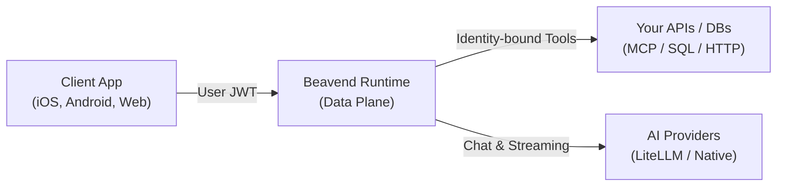

  

# Beavend Documentation

> **Bring your users, your data, your models.**  
> An open-source, provider-agnostic, application-facing AI backend.

---

## What is Beavend?

**Beavend** is an open-source, self-hosted AI backend runtime for web, mobile, and client applications. It provides a secure, managed gateway analogous to Firebase AI Logic while remaining 100% provider-agnostic, identity-agnostic, and data-agnostic.

Beavend mediates requests between your authenticated client applications and AI model providers (such as Gemini, OpenAI, Anthropic, or local Ollama instances), while fetching live application data on behalf of verified users via customizable tools.

---

## Core Guarantees

* **Zero-DB Request Hot Path**: All project configuration, Google CEL policies, model routes, and tool schemas compile into immutable in-memory snapshots. Request handlers never touch PostgreSQL for configuration.
* **Bring Your Own Identity**: Validate and normalize JWTs from Firebase Auth, Supabase Auth, or generic OIDC providers. Key rotation and JWKS caching are fully automated.
* **Confused-Deputy Defense**: Tools can declare `identity_bindings` that automatically strip LLM-supplied user parameters and inject verified claims directly from the authenticated caller's JWT token.
* **Built-in SSRF Guard**: Downstream HTTP tool executions run on custom transports with DNS-rebinding-safe dialers that strictly reject loopback, private RFC1918 subnets, and cloud metadata endpoints.
* **Bounded Agent Loop & Confirmations**: Tools with side effects (`side_effect: write`) trigger human-in-the-loop confirmation events, suspending state statelessly in Redis.
* **Configuration as Code**: Export and import complete tenant environments via the admin dashboard or the `beavend config` CLI for seamless GitOps promotion.

---

## Documentation Roadmap

| Section | Description |
|---|---|
| [**Quickstart**](getting-started/quickstart.md) | Spin up the local development stack and access the embedded admin dashboard. |
| [**Docker Build & Run**](getting-started/docker.md) | Multi-stage Docker build, configuration parameters, and container orchestration. |
| [**Architecture & Call Flows**](architecture/overview.md) | Plane separation, snapshot compiler, and AST call flow diagrams generated via Graphify. |
| [**Authentication & Identity**](guides/auth-and-identity.md) | Setup Firebase Auth, Supabase Auth, or OIDC, JWKS caching, and identity claims. |
| [**Model Routing & Providers**](guides/model-routing-and-providers.md) | Configure LiteLLM, native OpenAI-compatible providers, fallbacks, and weighted routes. |
| [**CEL Policy Engine**](guides/cel-policies.md) | Author in-app authorization and tool execution policies with Google CEL expressions. |
| [**Tools & Extensibility**](guides/tools-and-executors.md) | Configure HTTP tools, MCP servers, parameterized SQL templates, and identity bindings. |
| [**Configuration as Code**](guides/config-as-code.md) | Manage project configuration declaratively with YAML/JSON export, import, and promotion. |
| [**API Reference**](reference/api.md) | Runtime Chat and SSE Stream endpoint contracts, tool confirmations, and error taxonomy. |
