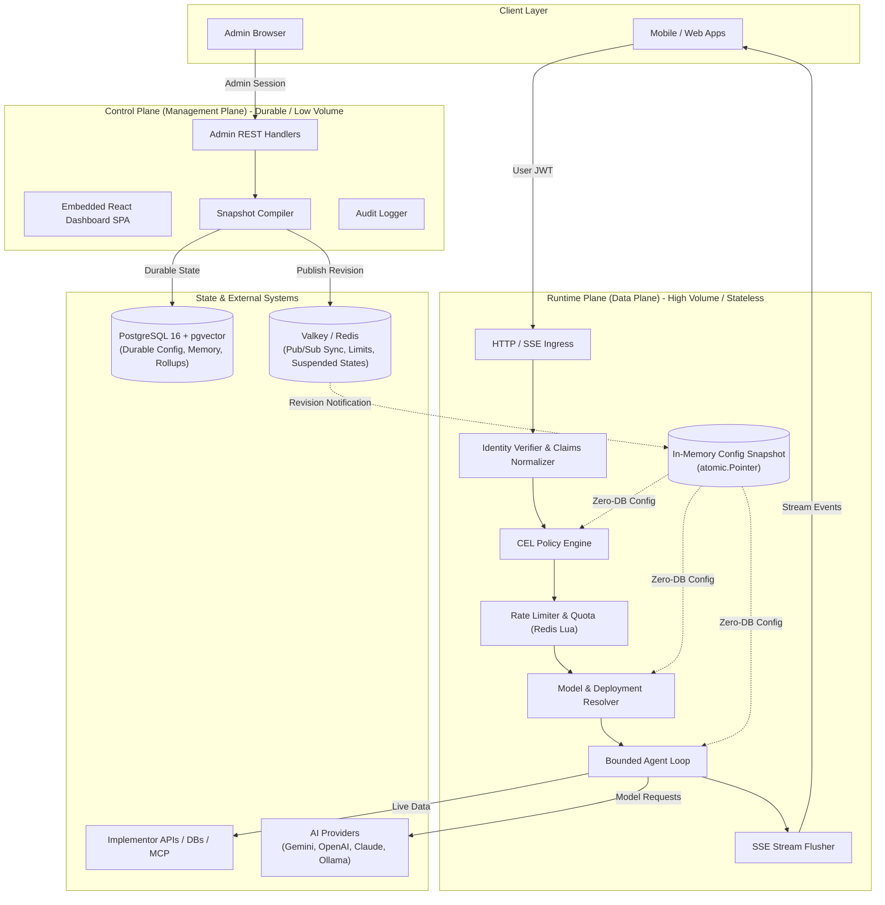
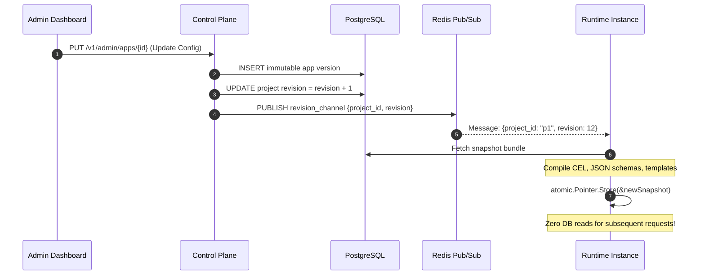
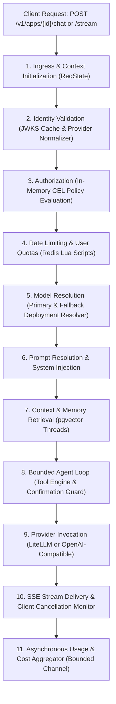

# Architecture & Call Flows

Beavend is architected as a **modular monolith** with a strict operational split between two distinct planes: the **Runtime Plane** (data plane) and the **Control Plane** (management plane).

---

## 1. System Overview & Planes

---

## 2. The Zero-DB Request Hot Path

The foundational architectural invariant of Beavend is that **the runtime request path never queries PostgreSQL for configuration**. 

### How Config Snapshots Work:

1. **Durable Edits in Control Plane**: When an admin updates an AI App, prompt template, model routing rule, or CEL policy in the dashboard, the change is written to PostgreSQL as an immutable, versioned record.
2. **Pub/Sub Invalidation**: The control plane publishes a lightweight revision message (`{"project_id": "...", "revision": 42}`) over Redis pub/sub (with a Postgres `LISTEN`/`NOTIFY` fallback).
3. **Pre-Compilation**: Upon receiving the notification, every runtime instance fetches the latest configuration and compiles it into an immutable in-memory `Snapshot`:
   * Google CEL expressions are compiled into executable `cel.Program` bytecodes.
   * Tool arguments are compiled into validated JSON schemas.
   * Prompt templates are parsed and cached.
4. **Atomic Pointer Swap**: The compiled snapshot is atomically swapped into memory using Go's `atomic.Pointer[*Snapshot]`. Active in-flight requests retain their initial snapshot reference to prevent mid-request configuration drift.

---

## 3. Runtime Request Call Flow (AST Synthesis)

Extracted from Beavend's AST analysis via **Graphify**, the execution lifecycle of a client AI chat or streaming request follows a deterministic pipeline managed by `ReqState`:

### Key Hubs (God Nodes) Identified by Graphify:

* **`Snapshot` & `NewSnapshot()`**: Central architectural hub maintaining all pre-compiled structures, eliminating database overhead.
* **`ReqState`**: Thread-safe pipeline carrier propagating project ID, validated identity, snapshot pointer, telemetry contexts, and active tool states across stages.
* **`Resolver`**: Manages logical model translation, deployment weights, and automatic failovers across provider adapters.
* **`ProviderAdapter`**: Common interface decoupling Beavend runtime logic from underlying LLM protocols (LiteLLM, native OpenAI-compatible, Ollama).
* **`SafeDialer`**: Custom SSRF-safe network transport guarding all external tool HTTP requests.

---

## 4. Bounded Agent Loop & Human Confirmation

When tools are enabled for an AI App, Beavend's runtime runs a bounded execution loop:

1. **Loop Depth Boundary**: The agent loop is strictly capped by `max_depth` (default: 5 iterations) to prevent runaway costs or infinite tool recursion.
2. **Side-Effect Detection**: Tools marked with `side_effect: write` default to `confirmation: required`.
3. **Stateless Freezing**: When confirmation is triggered:
   * Execution state is serialized and stored in Redis under `pend:{project}:{req_id}` with a 5-minute TTL.
   * A cryptographically signed HMAC confirmation token is returned to the client binding `{req_id, tool_id, args_hash, user_subject}`.
   * An SSE `confirmation` event is emitted, and the connection closes.
4. **Stateless Resumption**: The client reviews the tool parameters and calls `POST /v1/apps/{id}/confirm`. Any runtime instance in the cluster can verify the HMAC signature, retrieve the frozen state from Redis, execute the tool, and complete the response.
