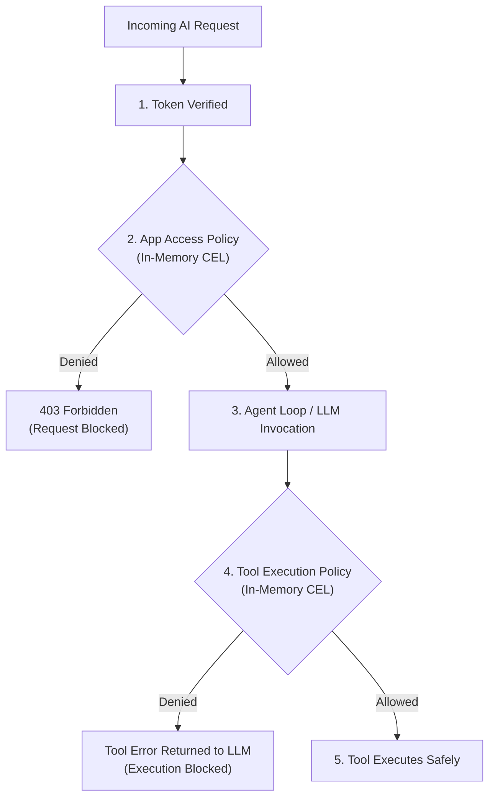

# Beavend CEL Policy Engine

Beavend uses **Common Expression Language (CEL)** to provide fast, dynamic, in-memory authorization for AI applications and tool executions.

> [!NOTE]
> **Beavend CEL vs Cloud IAM**: CEL in Beavend is **not** an external Google Cloud IAM service. Beavend embeds an in-process CEL compiler and evaluator directly in its Go runtime ([`internal/policy`](https://github.com/beavend/beavend/blob/master/internal/policy)). Policies are compiled ahead-of-time during snapshot synchronization and evaluated in-memory with sub-millisecond execution times.

---

## 1. Where Policies Are Enforced

Beavend evaluates CEL policies at two distinct stages in the request lifecycle:



1. **App Access Policies**: Evaluated at request ingress. If the policy denies access, Beavend rejects the request immediately with HTTP `403 forbidden`, preventing unauthorized LLM invocation and saving token costs.
2. **Tool Execution Policies**: Evaluated dynamically inside the agent loop right before an individual tool is invoked. If denied, the tool execution is blocked and an authorization failure message is returned to the model.

---

## 2. Evaluation Context & Namespaces

Every CEL expression evaluated in Beavend has access to three strictly isolated context maps:

### 1. `claims` (Caller's JWT Claims)
Contains all parsed claims extracted from the end-user's verified identity token:
* `claims.sub` *(string)*: User identifier.
* `claims.email` *(string)*: User email address.
* `claims.role` *(string)*: User role (e.g., `admin`, `member`, `guest`).
* `claims.tier` *(string)*: Subscription tier (e.g., `free`, `pro`, `enterprise`).
* Any custom claim included by your auth provider (e.g. `claims.org_id`, `claims.department`).

### 2. `identity` (Normalized Identity Metadata)
Contains Beavend's normalized caller metadata:
* `identity.project` *(string)*: The Beavend Project ID.
* `identity.environment` *(string)*: The current environment (`development`, `staging`, `production`).
* `identity.subject` *(string)*: Authenticated caller subject.
* `identity.issuer` *(string)*: Identity provider issuer URL.
* `identity.audience` *(string)*: Token audience.

### 3. `meta` (Runtime & Request Context)
Contains request parameters and environment metadata:
* `meta.app_id` *(string)*: ID of the AI App being accessed.
* `meta.model` *(string)*: Target logical model.
* `meta.tool_name` *(string)*: Name of the tool being evaluated (during tool authorization).
* `meta.client_ip` *(string)*: Client IP address.

---

## 3. Practical Policy Recipes

### Recipe 1: Role-Based Application Access (RBAC)
Allow access only to users with the `admin` or `operator` role:
```cel
claims.role in ["admin", "operator"]
```

### Recipe 2: Domain Email Restriction
Ensure only internal company employees can access internal support apps:
```cel
claims.email.endsWith("@mycompany.com")
```

### Recipe 3: Tier-Gated Model Access
Allow access only if the user is on the `pro` or `enterprise` tier:
```cel
claims.tier in ["pro", "enterprise"]
```

### Recipe 4: Multi-Tenant Isolation
Ensure the user's token belongs to the organization specified in the request metadata:
```cel
claims.organization_id == meta.org_id
```

### Recipe 5: Tool Execution Guard
Restrict high-privilege write tools (e.g. `execute_database_migration`) strictly to senior engineers:
```cel
claims.department == "engineering" && claims.level >= 3
```

---

## 4. Policy Configuration Format

In Beavend's configuration (via Admin Dashboard, REST API, or YAML Config-as-Code):

```yaml
policies:
  - id: "policy-require-pro"
    name: "Require Pro Subscription"
    description: "Blocks free tier users from advanced reasoning apps"
    expression: 'claims.tier in ["pro", "enterprise"]'
    action: "allow"
    error_message: "This AI feature requires a Pro or Enterprise subscription."
```

If an incoming request evaluates to `false`, Beavend halts execution and returns:

```json
{
  "error": {
    "code": "POLICY_DENIED",
    "message": "This AI feature requires a Pro or Enterprise subscription.",
    "status": 403
  }
}
```
